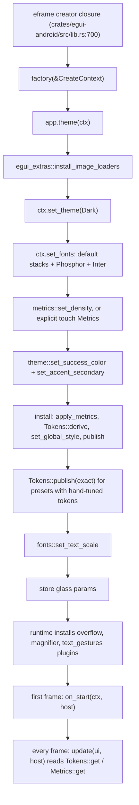

# MTech design system for EguiMobile apps

Written 2026-10-14. MasterTech paths are written `MastertechProject/<path>:<line>` and refer to
MastertechProject `main` @ `5cfbd160` (github.com/shadowbrok3r/MastertechProject, public). Bare
paths are EguiMobile @ `3677b26`, plus the two files in `docs/` added with this document.
Paths such as `egui-0.36.2/src/...` point into the crates.io sources of
that version. The theme file this document describes, `docs/mtech-default-theme.json`, ships next
to it.

## 1. What this is

This is the handoff for apps built on EguiMobile, and for plain eframe desktop apps, that want
MasterTech's egui design system and its default theme. It covers Android and desktop only.

It gives you four things:

- **The design system** (§3 to §9): bundled fonts, an app-owned geometry table, opaque colour
  tokens, a self-painted control kit, an SVG icon pack, desktop window chrome, and card lists that
  hold their width. All of it lives in the `mtech-ui` crate except the fixed-width card frame
  (`FixedWidthFrame`) and the glass, which are in MasterTech's
  `MastertechProject/displays/src/ui_tools/glass_card.rs` and `glass_backdrop.rs`. mtech-ui also
  carries MasterTech-only modules a new app should skip: `github.rs` (issue filing), the
  feature-gated `stress_dashboard`, and the stress-lab colour helpers in `theme.rs`.
- **MTech Default** (§10): the theme the account that exported it sees after logging in. Every
  account installs its own saved `color_scheme` at login, and an account with none gets Shipped
  Classic. It is that account's saved theme, exported to `docs/mtech-default-theme.json`. §10
  specifies every value it renders with and gives an install module.
- **MTech Studio** (§11): MasterTech's hand-tuned built-in preset, with exact tokens.
- **Adoption in EguiMobile** (§12): where each piece goes in an `EguiApp`, what changes on a phone
  (touch metrics, text scale, IME, insets, icons, glass, lifecycle), and how the new system
  relates to the styles EguiMobile already ships.

How to read it: §2 is the overview. Each layer section says what the layer does, where it lives,
its exact values, and how to port it. §13 is the ordered checklist. §14 to §16 are the rules,
guardrails and traps. §17 indexes every file mentioned.

How the facts were checked:

- **MTech Default and MTech Studio values are measured**, not estimated. A throwaway crate linked
  `MastertechProject/mtech-ui` by path, decoded the JSON the way MasterTech does, ran the real
  overlay and `Tokens::derive`, and printed the result (§10.9).
- **Kit geometry, touch hit-testing, the IME text-field contract and the overflow guard** were
  checked in headless egui 0.36.2 frames on Windows, with `egui-mobile-core` from this repo.
- **Android-only code was not compiled.** The machine that wrote this has no Android NDK, so
  nothing behind `#[cfg(target_os = "android")]` (`app!`, `Backend::Glow`, `glow_context`,
  `with_native_activity`, backdrop-blur frosting) was built for `aarch64-linux-android`. Snippets
  that touch it are fenced `rust,ignore` and say so.

## 2. The system at a glance

### Layers

| Layer | Home | What it owns | State it publishes |
|---|---|---|---|
| Fonts and text scale | `mtech-ui/src/fonts.rs`, `fonts/sfnt.rs` | Inter faces, `medium` / `semibold` families, glyph scale | temp `"mtech.fonts.text_scale"` |
| Metrics and density | `mtech-ui/src/metrics.rs` | control heights, padding, gaps, margins, widths, icon sizes, type scale | temp `"mtech.metrics"`, `"mtech.metrics.density"` |
| Tokens | `mtech-ui/src/tokens.rs` | 26 opaque colours and 3 radii | temp `"mtech.tokens"` |
| Semantic roles | `mtech-ui/src/theme.rs` | success and secondary colours, palettes | temp `"mtech.theme.success_color"`, `"mtech.theme.accent_secondary"` |
| Visuals | a theme's `egui::Style` | colours and chrome only | the egui style slot |
| Control kit | `mtech-ui/src/controls/*.rs` | buttons, fields, menus, rows, bars, dialogs | none of its own |
| Icons | `mtech-ui/build.rs`, `icon_pack.rs`, `icons.rs` | 450 SVG icons plus Phosphor glyphs | none |
| Window chrome | `mtech-ui/src/title_bar.rs` | frameless title strip, resize edges | viewport commands |
| Cards, layout, glass | `mtech-ui/src/controls/layout.rs`, MasterTech `displays/src/ui_tools/glass_card.rs`, `glass_backdrop.rs` | card frames, fixed-width card rows, backdrop blur | temp `"mtech.theme.glass_params"` |

All MasterTech paths in this table are under `MastertechProject/`. Every piece of state is egui
temp data (`ctx.data`), so a fresh `egui::Context` starts without any of it.

### The core idea

**The app owns geometry and typography. A theme only owns colour.** A stock egui theme changes
spacing, stroke widths, radii and font sizes along with its colours, so switching themes moves
every control. MasterTech stops that in three ways:

- A theme is a `Style` that supplies colours. `metrics::apply_metrics` then overwrites spacing,
  text sizes and widget-state geometry. It is idempotent, replaces any earlier density, and never
  changes a colour (`MastertechProject/mtech-ui/src/metrics.rs:187-230`, tests from `:280`).
- Kit controls do not use stock egui widget chrome. Each one paints its own box from `Tokens` and
  `Metrics`, so every row control is exactly `Metrics::control_h` tall on one centre line, whatever
  the theme. The text and numeric fields host a frameless `TextEdit` / `DragValue` inside that box
  for editing.
- Every install goes through **one funnel**, `metrics::install_overlaid_style`
  (`MastertechProject/mtech-ui/src/metrics.rs:164-175`). It overlays the metrics, derives the
  tokens, installs the style and publishes both. Widgets read `Tokens::get` and `Metrics::get`
  every frame, so a theme change needs no other wiring.

### Versions

| Crate | MasterTech @ `5cfbd160` | EguiMobile @ `3677b26` |
|---|---|---|
| egui, epaint, eframe | 0.36.2 | 0.36.2 (eframe patched, `patches/eframe`) |
| winit | 0.30.13 | 0.30.13 (patched, `patches/winit`) |
| egui_extras | 0.36.2 (the kit needs only `svg`) | not in `Cargo.lock` |
| egui-phosphor | 0.14.0, `regular` only | not in `Cargo.lock` |
| egui_dock | 0.21.1 | not in `Cargo.lock` |
| resvg | 0.45.1 (mtech-ui dev-dependency) | not in `Cargo.lock` |
| Inter | 4.001, bundled TTFs | none |
| Phosphor icons (SVG) | @phosphor-icons/core 2.1.1, MIT, bundled | none |

`mtech-ui` is edition 2024, and its let-chains (`MastertechProject/mtech-ui/src/metrics.rs:266`)
need Rust 1.88. egui, eframe and egui_extras 0.36.2 declare `rust-version = "1.95"`, so every app
on this stack needs Rust 1.95 or newer, the same floor `patches/backdrop-blur` states
(`patches/backdrop-blur/Cargo.toml:10-11`).

### Install order

In an EguiMobile app everything up to the first frame happens inside `EguiApp::theme`, which the
Android runtime calls once per `egui::Context` (`crates/egui-android/src/lib.rs:714-719`).



Order constraints:

- `icons::install_fonts` before `fonts::install`, because `fonts::install` copies the Proportional
  stack, which must already hold `phosphor`, into the weight families.
- Fonts before any style whose Heading uses the `semibold` family is laid out. The overlay sets
  that family on proportional themes, and epaint panics on an unbound family (§16).
- Semantic colours before the install, because `Tokens::derive` reads them then.
- Hand-tuned tokens after the install, because the install publishes derived ones.

## 3. Fonts and text scale

### What it does

- Embeds Inter Regular, Medium and SemiBold with `include_bytes!`
  (`MastertechProject/mtech-ui/src/fonts.rs:22-24`). There is no runtime file IO, which is what
  Android needs: nothing in `crates/egui-android` exposes an APK asset path to Rust.
- `fonts::install` (`fonts.rs:52-83`) puts Inter first in `FontFamily::Proportional` and creates
  two named families, `"medium"` and `"semibold"`, each being the weight face followed by the whole
  Proportional stack, so icons and emoji still resolve inside bold text.
- Strips the BMP Private Use Area (U+E000..U+F8FF) from Inter's cmap. Each Inter face maps 745 PUA
  codepoints (measured), and Phosphor keeps its icons in the PUA, so before the strip Inter drew its
  own glyphs in place of Phosphor icons. The rewrite is
  `MastertechProject/mtech-ui/src/fonts/sfnt.rs`, cached once per process in a `OnceLock`
  (`fonts.rs:38-49`).
- Applies a user text scale by multiplying `FontData.tweak.scale` on every face in Proportional,
  Monospace, `medium` and `semibold` (`apply_text_scale`, `fonts.rs:150-171`). It never touches
  `zoom_factor`, so control geometry and `pixels_per_point` stay put.

### Values

| Item | Value | Where |
|---|---|---|
| Type scale (pt) | Small 10.5, Body 12.5, Button 12.5, Heading 15.0, Monospace 12.0, at every density | `metrics.rs:178-184` |
| Heading family | `Name("semibold")` when Body is Proportional or absent; when Body is not Proportional, Heading keeps whatever family it had | `metrics.rs:232-269` |
| `TextScale` | `Small` 90, `Normal` 100 (default), `Large` 115, `XLarge` 130; labels `"Small · 90%"` ... `"Extra large · 130%"` | `fonts.rs:120-148` |
| Inter file sizes | Regular 411,640 B, Medium 417,300 B, SemiBold 419,744 B | `MastertechProject/mtech-ui/assets/fonts/` |
| Licence | SIL OFL 1.1, `OFL-Inter.txt`; ship it with the fonts | same folder |

Stacks after `icons::install_fonts` then `fonts::install` on `FontDefinitions::default()`
(measured):

| Family | Faces in order |
|---|---|
| Proportional | `Inter, Ubuntu-Light, phosphor, NotoEmoji-Regular, emoji-icon-font` |
| Monospace | `Hack, phosphor, Ubuntu-Light, NotoEmoji-Regular, emoji-icon-font` |
| `medium` | `Inter-Medium, Inter, Ubuntu-Light, phosphor, NotoEmoji-Regular, emoji-icon-font` |
| `semibold` | `Inter-SemiBold, Inter, Ubuntu-Light, phosphor, NotoEmoji-Regular, emoji-icon-font` |

MasterTech itself also puts a PUA-stripped `UbuntuMonoNerdFont` first in Monospace and adds
terminal faces (`MastertechProject/displays/src/app_state.rs:1304-1366`). Other apps do not need
them.

### How to port

Build fonts from fresh definitions every time and hand the builder to `fonts::set_text_scale`,
which rebuilds only when the scale changes (`fonts.rs:184-197`). So set the fonts at the target
scale yourself on every install, including reinstalls in a living context:

```rust,ignore
use egui::FontDefinitions;
use mtech_ui::fonts::{self, TextScale};

/// egui's default stacks plus Phosphor and Inter, scaled to `scale`.
pub fn font_definitions(scale: TextScale) -> FontDefinitions {
    let mut defs = FontDefinitions::default();
    mtech_ui::icons::install_fonts(&mut defs);
    fonts::install(&mut defs);
    fonts::apply_text_scale(&mut defs, scale);
    defs
}

// Builds at the target scale and records it.
ctx.set_fonts(font_definitions(saved_scale));
fonts::set_text_scale(ctx, saved_scale, font_definitions);
```

- **Start from `FontDefinitions::default()`, never `empty()`.** EguiMobile's runtime draws its
  Paste / Copy / Cut bar with the emoji 📋 📄 ✂ (`crates/egui-android/src/text_actions.rs:289-294`),
  which come from egui's default NotoEmoji and emoji-icon-font. Keep eframe's `default_fonts`
  feature on (`crates/egui-android/Cargo.toml:16-21` already does).
- Any extra face placed ahead of `phosphor` must go through `fonts::without_private_use` with its
  own `static OnceLock`. It only rewrites faces with a format 12 cmap.
- If you save `Style`s, strip the weight families first, as MasterTech's
  `strip_weight_families` does (`MastertechProject/displays/src/ui_tools/mod.rs:94-103`).

Weighted text at call sites:

```rust,ignore
use mtech_ui::fonts::{self, RichTextExt};
use mtech_ui::metrics::type_scale;

ui.label(RichText::new("Title").semibold().color(t.text));
ui.label(RichText::new("Mode").medium());
ui.label(RichText::new("Name").font(fonts::semibold(type_scale::HEADING)));
```

## 4. Metrics, density and the install funnel

### What it does

`Density` picks a row of the `Metrics` table (`MastertechProject/mtech-ui/src/metrics.rs:17-130`).
`apply_metrics` writes that geometry and the type scale onto any `Style` and leaves every colour
alone. `install_overlaid_style` applies it, derives tokens, installs the style and publishes
`Metrics` and `Tokens`. `metrics::set_density` only records the density for the next install.

### The table

The Compact, Regular and Comfortable columns are mtech-ui's. The Touch column is the row this
document proposes for phones (§12.3); it is not in mtech-ui.

| Field | Compact | Regular | Comfortable | Touch (proposed) | Used for |
|---|---|---|---|---|---|
| `control_h` | 22 | 24 | 28 | 44 | fields, combos, buttons, every row control |
| `button_h` | 26 | 28 | 32 | 48 | prominent and dialog buttons |
| `pad` | 8, 3 | 10, 4 | 12, 6 | 14, 10 | `button_padding` |
| `gap` | 6, 4 | 8, 6 | 10, 8 | 10, 8 | `item_spacing` |
| `window_margin` | 10 | 12 | 16 | 16 | `Margin::same` |
| `menu_margin` | 4 | 6 | 8 | 8 | `Margin::same` |
| `radius_sm / md / lg` | 6 / 8 / 12 | 6 / 8 / 12 | 6 / 8 / 12 | 6 / 8 / 12 | **read by nothing**; radii come from `Tokens` |
| `combo_w` | 110 | 120 | 140 | 160 | |
| `slider_w` | 130 | 150 | 170 | 200 | |
| `tooltip_w` | 280 | 280 | 320 | 280 | |
| `icon_sm / md / lg` | 12 / 14 / 18 | 14 / 16 / 20 | 16 / 18 / 22 | 16 / 20 / 24 | SVG icon sizes |
| `row_h` | 22 | 24 | 28 | 48 | list and menu rows |
| `header_h` | 26 | 28 | 32 | 44 | section headers, header and status bars |
| `bar_h` | 32 | 36 | 40 | 56 | toolbars, title strip |
| `footer_h` | 28 | 32 | 36 | 56 | dialog and panel footers |

### What `apply_metrics` writes, and what it keeps

| Writes | Value |
|---|---|
| `spacing.interact_size` | `vec2(40.0, control_h)` |
| `spacing.button_padding`, `item_spacing` | `pad`, `gap` |
| `spacing.window_margin`, `menu_margin` | `Margin::same(window_margin)`, `Margin::same(menu_margin)` |
| `spacing.indent` | 16 |
| `spacing.combo_width`, `slider_width`, `tooltip_width` | `combo_w`, `slider_w`, `tooltip_w` |
| `spacing.icon_width`, `icon_width_inner`, `icon_spacing` | 14, 8, 6 |
| `spacing.menu_spacing`, `combo_height` | 2, 320 |
| `spacing.scroll` | `ScrollStyle::thin()` |
| text styles | the type scale; Heading in `semibold` on proportional themes |
| `override_font_id` | `None` |
| every widget state | stroke widths snapped to whole pixels (a visible stroke stays at least 1), `expansion = 0`, `corner_radius` = the inactive state's |
| `interaction.tooltip_delay` | 0.35 |
| `visuals.striped`, `indent_has_left_vline` | `false`, `false` |
| `visuals.handle_shape`, `slider_trailing_fill` | `HandleShape::Circle`, `true` |

It keeps `slider_rail_height`, `text_edit_width`, `default_area_size`, `menu_width`,
`extra_text_line_spacing`, `indent_ends_with_horizontal_line`, the rest of `interaction`, every
colour, the window and menu radii and every shadow.

The stroke and expansion rules exist because in egui 0.36 a fractional stroke width or a non-zero
`expansion` makes a stock button change size between states.

### The funnel

```rust,ignore
// MastertechProject/mtech-ui/src/metrics.rs:164-175
pub fn install_overlaid_style(ctx: &Context, mut style: Style) {
    let metrics = Metrics::for_density(density(ctx));
    apply_metrics(&mut style, &metrics);
    let tokens = Tokens::derive(
        &style,
        theme::success_ctx(ctx),
        theme::accent_secondary_ctx(ctx),
    );
    ctx.set_global_style(Arc::new(style));
    Metrics::publish(ctx, metrics);
    Tokens::publish(ctx, tokens);
}
```

MasterTech wraps it once more so presets with hand-tuned tokens republish them after every install
(`install_style`, `MastertechProject/displays/src/ui_tools/theme_config.rs:74-79`). Only MTech
Studio has hand-tuned tokens (`preset_tokens`, `theme_config.rs:82-87`).

To install with metrics that are not a `Density` row (the touch row), do what the funnel does with
your own `Metrics`. The §10.10 module has this as `install_with_metrics`.

### How to port

- Depend on or vendor `metrics.rs` unchanged; it needs `tokens.rs`, `theme.rs` and `fonts.rs`.
- Route every style change through one function. Never call `ctx.set_global_style`,
  `set_visuals` or `style_mut` on spacing anywhere else.
- `metrics::set_density` only records. Reinstall after it.
- With touch metrics, `metrics::density(ctx)` still reads the record's Compact. Never reinstall
  through `install_overlaid_style` or `metrics::set_density` on a phone: either drops it back to
  22 pt controls. Every reinstall goes through `apply_with(ctx, Some(TOUCH), ..)` or the preset's
  touch install, and a density picker is desktop-only.
- MasterTech's preset registry, saved-theme matching and theme editor
  (`MastertechProject/displays/src/ui_tools/theme_config.rs`, `mod.rs`) are app-specific. A new app
  needs only the decode path in §10.10.

## 5. Colour tokens and visuals

### What it does

`Tokens` (`MastertechProject/mtech-ui/src/tokens.rs:22-62`) is a `Copy` struct of 26 opaque colours
and 3 radii. Every install derives it from the installed `Style` and publishes it. Kit controls and
app UI paint only from `Tokens::get(ctx)`, so every theme gets the same control look in its own
palette. A preset can publish hand-tuned tokens over the derived ones.

### Fields

| Field | Role |
|---|---|
| `base` | panel background |
| `sunken` | troughs, plots, scroll tracks |
| `raised` | cards and grouped content on a panel |
| `window` | floating windows, menus, popups |
| `field` | text fields and resting controls |
| `field_border` | resting control outline |
| `hover`, `pressed` | control fills when hovered and pressed |
| `separator` | rules and hairlines |
| `card_border` | card and window outline |
| `text`, `text_dim`, `text_faint` | three text levels |
| `icon` | resting icon ink |
| `primary`, `primary_soft`, `primary_border`, `on_primary` | primary role, its wash, its outline, ink on it |
| `secondary`, `secondary_soft` | secondary role and its wash |
| `tertiary`, `tertiary_soft` | tertiary role and its wash |
| `success`, `warn`, `error`, `info` | status colours |
| `radius_sm`, `radius_md`, `radius_lg` | widget, menu and card, window corner radius |

### How `Tokens::derive` reads a style

`MastertechProject/mtech-ui/src/tokens.rs:66-122`. The backdrop is black in dark mode.
`composite(top, under)` paints a premultiplied colour over another and returns an opaque one.

| Token | Source |
|---|---|
| `base` | `composite(panel_fill, black)` |
| `window` | `composite(window_fill, base)` |
| `raised` | first of `noninteractive.bg_fill`, `window_fill`, `faint_bg_color` that differs from `base` once composited, else `mix(base, ink_on(base), 0.05)` |
| `field` | `composite(text_edit_bg_color(), base)`; `text_edit_bg_color()` falls back to `extreme_bg_color` |
| `field_border` | `inactive.bg_stroke` colour if visible, else `noninteractive.bg_stroke`, over `field` |
| `text`, `text_dim` | `text_color()`, `weak_text_color()` over `base` |
| `sunken` | `extreme_bg_color` over `base` |
| `hover`, `pressed` | `weak_bg_fill` of `hovered` / `active` (or `bg_fill` when the weak fill is invisible) over `base` |
| `separator` | `noninteractive.bg_stroke` colour over `base` |
| `card_border` | `window_stroke` colour over `raised` |
| `text_faint` | `mix(base, text_dim, 0.65)` |
| `icon` | `mix(text_dim, text, 0.5)` |
| `primary` | the most chromatic hue among `selection.bg_fill`, `selection.stroke.color`, `hyperlink_color` whose alpha is at least 64 |
| `primary_soft` | `mix(base, primary, 0.18)` |
| `primary_border` | `mix(field, primary, 0.65)` |
| `on_primary` | `#0C0C0E` or `#FAFAFC`, whichever has more contrast on `primary` |
| `secondary`, `success` | the stashed roles over `base` |
| `secondary_soft`, `tertiary_soft` | `mix(base, role, 0.18)` |
| `tertiary`, `info` | `hyperlink_color` over `base` |
| `warn`, `error` | `warn_fg_color`, `error_fg_color` over `base` |
| radii | `inactive.corner_radius.nw`, `menu_corner_radius.nw`, `window_corner_radius.nw` |

`composite` and `contrast` (the WCAG ratio) are public; `mix` and `ink_on` are `pub(crate)`.
`Tokens::get` returns the published tokens, or silently derives them when none were published.

### Semantic accessors

`MastertechProject/mtech-ui/src/theme.rs`: `set_success_color` and `set_accent_secondary`
(`:22-29`) stash the two roles egui has no slot for; their defaults are rgb(72, 199, 142) and
rgb(191, 33, 101). `primary`, `secondary`, `tertiary` (`:66-90`) read `Tokens` and are for ink.
`accent(ui)` (`:52`) is `selection.bg_fill`, a wash for fills only. `faint_text` (`:107`) is
translucent and is not `Tokens::text_faint`. The stress-lab helpers (`chart_palette`,
`core_series_color`, `result_*`, `usage_level`, `temp_level`) are MasterTech vocabulary.

### Painting from tokens

The kit's button table (`MastertechProject/mtech-ui/src/controls/buttons.rs:212-250`) shows the
pattern every control follows:

| Kind | Rest (fill, edge, ink) | Hovered | Pressed |
|---|---|---|---|
| Neutral | `field`, `field_border`, `text` | `hover`, `field_border`, `text` | `pressed`, `primary_border`, `text` |
| Primary | `primary`, none, `on_primary` | primary mixed 10 % toward white | primary mixed 18 % toward black |
| Danger | `mix(field, error, 0.14)`, `mix(field, error, 0.55)`, `error` | wash 0.22 | wash 0.30 |
| Ghost | none, none, `text_dim` | `hover`, none, `text` | `pressed`, none, `text` |

## 6. The control kit

### Principles

Every control in `mtech_ui::controls`:

1. allocates an exact rect (`ui.allocate_exact_size`); TextArea is the exception: it wraps its
   editor in a `Frame` and grows with its rows;
2. reads `(Tokens, Metrics)` at draw time through `kit(ui)` and never caches them
   (`MastertechProject/mtech-ui/src/controls/mod.rs:113`);
3. resolves Rest, Hovered and Pressed with `state_of` (`mod.rs:86-106`), which returns Rest on a
   disabled `Ui`;
4. paints a fill and a 1 px inside border (`paint_box`, `mod.rs:183-191`) and a 2 px `primary`
   outside focus ring (`focus_ring`, `mod.rs:194-201`), so borders never grow the rect;
5. lays text out with `Color32::PLACEHOLDER` and colours it at paint time, eliding with `…`;
6. reports width 0 during a sizing pass (`fill_width`, `mod.rs:220-226`) so popups size to content;
7. sets `response.widget_info(..)` with the right AccessKit type;
8. disables itself by re-entering through `ui.add_enabled_ui(false, ..)`.

The helpers in items 2 to 6 are `pub(crate)`. **A new control that should look native must live in
the kit crate.** That is one reason §12.1 recommends vendoring.

### Catalogue

Heights are at the installed metrics.

| Control | API (`controls::`) | Height |
|---|---|---|
| Text button | `TextButton::new(label)` with `.kind() .icon() .prominent() .min_width() .max_width() .ink() .mono() .enabled() .show(ui)`; `button`, `primary_button`, `secondary_button`, `danger_button`, `ghost_button`, `icon_text_button` | `control_h`, `button_h` when prominent |
| Icon button | `IconButton::new(icon, IconBox)` with `.selected() .tip() .tint() .enabled()`; `icon_button(ui, icon, size, selected, tip)` | Sm `control_h - 4`, Md `control_h`, Lg `button_h`, Tool `bar_h - 4` (`buttons.rs:300-319`) |
| Text field | `TextField::new(&mut s)` with `.hint() .width() .icon() .mono() .password() .clear_button() .invalid() .char_limit() .cursor_at_end() .id_salt() .enabled()`; `text_field`, `search_field` | `control_h` |
| Text area | `TextArea::new(&mut s)` with `.hint() .width() .rows() .mono() .invalid() .tab_indents() .char_limit() .id_salt()` | grows with rows |
| Numeric field | `ValueField::new(&mut v, range)` with `.suffix() .width() .speed() .formatter() .parser()`; `value_field` | `control_h` |
| Dropdown | `Dropdown::new(salt, &mut v, &options)`; `dropdown(ui, salt, &mut v, &options, width)` | `control_h` |
| Toggle, checkbox | `toggle(ui, &mut on, label)`, `checkbox(ui, &mut on, label)` | `control_h` row |
| Slider, progress | `Slider::new(&mut v, range)`; `ProgressBar::new(f)`, `meter` | `control_h`; `meter` and `ProgressBar::thin(true)` are 4 pt |
| Segmented, pill | `segmented(..)`, `Pill::new(label)` | `control_h` |
| Badge | `badge(ui, text, tone)`, `count_badge(..)` | `control_h - 6`, or the text if taller (`labels.rs:745-749`) |
| Labels and links | `IconLabel`, `icon_label`, `status_label`, `note`, `elided_label`, `section_label`; `IconLink`, `icon_link` | text line |
| Headings, sections | `heading`, `subheading`; `Section::new(salt, title)`, `section_header`, `fold_header` | `heading` max(text, `icon_lg`); `subheading` max(text, `icon_md`); section headers a hairline plus `header_h` |
| Rules, spinners | `hairline`, `vline(ui, h)`; `spinner(ui, SpinnerSize)`, `loading_row`, `loading_state` | |
| Bars | `bar(ui, BarKind::Tool / Header / Status / Footer, add)` | `bar_h` / `header_h` / `header_h` / `footer_h` |
| Dialogs | `modal(ctx, id, icon, title, ModalWidth, &buttons, body)` returning `ModalOutcome`; `Role` | buttons `button_h` |
| Empty state | `empty_state(ui, icon, title, hint, &actions)` | |
| Menus | `MenuButton::new(label)`, `menu_item`, `menu_check_item`, `menu_danger_item`, `submenu`, `menu_body`, `menu_separator`, `menu_inset_row` | trigger `control_h`, rows `row_h` |
| List rows | `ListItem::new(label)` with `.icon() .selected() .detail() .subtitle() .trailing() .spinner()` and `.show() / .show_node()` | `row_h`; taller with `.subtitle()` or `.progress()` |
| Surfaces | `panel_header`, `callout(ui, tone, icon, add)`, `card(ui, add)`, `card_frame(ui)` | |
| Dock tab title | `tab_title(icon, title)` (`layout.rs:792`) | |
| Gallery | `gallery(ui)` (`gallery.rs:118`): every control in rest, hover, pressed, focus and disabled | |

**The gallery is desktop-sized.** At 360 pt wide it hits the overflow guard's cap of 8 reports per
frame at both Compact and the touch row (measured), so at least 8 widgets are clipped: each state
row lays five controls side by side.
Inside a horizontal `ScrollArea` with `overflow::allow(ui)` it still raises 3, from popups it
opens. Its sample content is MasterTech-specific.

### Usage

Compiled against mtech-ui at `5cfbd160`:

```rust,ignore
use egui::Id;
use mtech_ui::controls::{self, *};
use mtech_ui::icons::svg;

let m = Metrics::get(ui.ctx());
if controls::primary_button(ui, "Save").clicked() { /* save */ }
let _ = TextButton::new("Delete").icon(svg::TRASH).kind(ButtonKind::Danger).show(ui);
let _ = icon_button(ui, svg::GEAR, IconBox::Md, false, "Settings");
let _ = search_field(ui, &mut search, "Search", 160.0);
let _ = ValueField::new(&mut threads, 0..=64).width(76.0).suffix("thr").show(ui);
let _ = dropdown(ui, "density", &mut density, &densities, 130.0);
let _ = toggle(ui, &mut live, "Live updates");

bar(ui, BarKind::Tool, |ui| {
    let _ = icon_button(ui, svg::PLAY, IconBox::Md, false, "Run");
    vline(ui, m.control_h - 8.0);
    let _ = ghost_button(ui, "Clear");
});

let (_button, _) = MenuButton::new("View").icon(svg::TABS).show(ui, |ui| {
    let _ = menu_check_item(ui, svg::LIST_CHECKS, "My tasks", true);
    menu_separator(ui);
    let _ = menu_danger_item(ui, svg::TRASH, "Delete file");
});

let outcome = controls::modal(
    ui.ctx(),
    Id::new("confirm_delete"),
    svg::TRASH,
    "Delete file?",
    ModalWidth::Narrow,
    &[(Role::Danger, "Delete"), (Role::Cancel, "Cancel")],
    |ui| ui.label("This cannot be undone."),
);
if outcome.should_close {
    confirm_open = false;
}

let _ = ListItem::new("Downloads").icon(svg::DOWNLOAD).selected(true).show(ui);
```

### How to port

Depend on or vendor `controls/` whole. Rewrite the gallery's samples ("Laptop intake",
"DESKTOP-3C0R0D7", the `mt-*` icon section) for your app, and keep its `states()` helper.

## 7. Icons

### Two paths

1. **SVG pack (preferred).** `MastertechProject/mtech-ui/build.rs` turns each
   `assets/icons/regular/*.svg` into a `pub const NAME: Icon` in a generated `icon_table.rs`, with
   an optional duotone back layer from `assets/icons/duo/`. Each icon embeds its SVG with
   `include_bytes!`, is rasterised by egui_extras' SVG loader at the exact physical pixel size, and
   is tinted from a token. Use it as `mtech_ui::icons::svg::NAME`.
2. **Phosphor font** (`egui_phosphor` 0.14, as `icons::p`), only for APIs that take text: dock tab
   titles, third-party widgets, inline strings. Every SVG `Icon` carries its glyph (`icon.glyph()`).

The pack has 450 icons: 439 Phosphor Regular icons and 11 MasterTech `mt-*` glyphs. 449 have a duo
layer. The SVGs total 308,083 bytes (223,526 regular, 84,557 duo).

| Item | Location |
|---|---|
| `Icon` | `MastertechProject/mtech-ui/src/icon_pack.rs:12` |
| `find`, `from_glyph` | `icon_pack.rs:47`, `:54` |
| `image(size)` (untinted, not pixel-snapped) | `icon_pack.rs:82` |
| `show`, `show_tinted` | `icon_pack.rs:87`, `:93` |
| `paint`, `paint_duo` (snapped to whole physical pixels) | `icon_pack.rs:102`, `:108` |
| Phosphor font install | `MastertechProject/mtech-ui/src/icons.rs:8-24` |
| attribution | `MastertechProject/mtech-ui/assets/icons/ATTRIBUTION`, `LICENSE` (MIT) |

### Sizes and tints

| Use | Size | Tint |
|---|---|---|
| next to Small text | `icon_sm` | the label tone, or `text_faint` for section labels |
| next to Body or Button text, menus, buttons | `icon_md` | `icon` at rest, `text` hovered or pressed |
| headings, dialog titles | `icon_lg` | duotone `primary` over `primary.gamma_multiply(0.30)` to `0.35` |
| empty states | 40 pt | duotone `text_faint` |
| on a primary fill | context | `on_primary` |

```rust,ignore
svg::WARNING.show_tinted(ui, Metrics::get(ui.ctx()).icon_sm, theme::warn(ui));
svg::CPU.paint_duo(ui, rect, 20.0, t.primary, t.primary.gamma_multiply(0.35));
```

### How to port

- The app must enable an egui_extras SVG loader and call `egui_extras::install_image_loaders` once
  per `Context`, including test contexts. `mtech-ui` only dev-depends on egui_extras.
- Keep `egui-phosphor`: the generated table names `egui_phosphor::regular::*` constants.
- Replace the 11 `mt-*` glyphs with your own prefix, or drop them and update the icon tests.
- This satisfies the house rule that egui icons come from Phosphor; EguiMobile's examples use emoji
  and hand-drawn shapes today (`examples/appstore-android/src/icons.rs:9-17`,
  `examples/privaxy-android/src/ui/icons.rs`).

## 8. Window chrome (desktop eframe apps only)

This section applies to desktop eframe windows. Android has no window decorations to replace.

`mtech_ui::title_bar::TitleBar` (`MastertechProject/mtech-ui/src/title_bar.rs:92`, `show` at `:127`)
draws a frameless title strip `Metrics::bar_h` tall, filled with `base` over a 1 px `separator`
rule: a duotone mark, a left and a right slot filled by a caller closure, a centred dim title, and,
when frameless, minimize, maximize and close buttons plus drag regions. `window_edges(ui)` (`:354`),
called last each frame, adds 8 pt edge and 12 pt corner resize zones (`EDGE`, `CORNER`, `:18-20`).
Close hovers `#C42B1C` and presses `#A02418` (`:30-32`).

```rust,ignore
let mut bar = TitleBar::new("app.title_bar", "My App").frameless(frameless);
if frameless {
    bar = bar.mark(svg::CPU);
}
let _ = bar.show(ui, |ui, side| match side {
    Side::Left => self.bar_left(ui),
    Side::Right => self.bar_right(ui),
});
// Pages, dock or central panel go here.
if frameless {
    mtech_ui::title_bar::window_edges(ui);
}
```

Launch with `ViewportBuilder::with_decorations(!frameless)`. On Windows, MasterTech also subclasses
the root window to clamp a 1 px client-rect overhang that winit's undecorated shadow causes
(`MastertechProject/Mastertech4.0/src/utilities/windows/client_area.rs`, installed at
`Mastertech4.0/src/main.rs:503`); copy it for any Windows glow app that drops decorations. Keep an
escape hatch such as a `--system-titlebar` flag.

`mtech_ui::dock_style::style(ctx)` (`MastertechProject/mtech-ui/src/dock_style.rs:31`) builds an
egui_dock style from tokens: rounded cards on an 8 pt gutter, 6 pt separators, pill tabs at
`control_h`. Pair it with `controls::tab_title(icon, title)` in `TabViewer::title` and paint `base`
behind the `DockArea`. Phones do not dock, which is why §12.1 puts it behind a feature.

## 9. Cards, layout and glass

### Cards

- `controls::card_frame(ui)` / `controls::card(ui, add)`
  (`MastertechProject/mtech-ui/src/controls/layout.rs:909-925`): token-based and content-sized. Fill
  is `window`, or `mix(raised, hover, 0.5)` when the two are equal; 1 px `card_border`; `radius_md`.
- MasterTech's own card system is `MastertechProject/displays/src/ui_tools/glass_card.rs`, in the
  app crate: `card_fill` (`:56-67`), `card_stroke`, `card_frame`, a frosted `card`, `group`, and
  the fixed-width card row below.

**Card lists use `FixedWidthFrame`.** An egui `Frame` is sized by its content, and allocating a rect
wider than the parent grows the parent, so one over-wide card widens every card after it. On a phone
that also trips the overflow guard. `FixedWidthFrame` (`glass_card.rs:147-221`) fixes the outer left
edge and width when it begins, clips content to it, and never reports a wider rect. This version
uses the kit's `card_frame`; at 360 pt with an 80-character unspaced word inside (egui wraps it),
three cards held `x 8..352` and the overflow guard reported nothing (measured). A child that cannot
wrap (`Label::extend()`) still leaves the cards at `x 8..352`, but the guard reports it as clipped.
Neither type is in mtech-ui, so the app adds this module itself:

```rust
//! Card rows of a fixed outer width, after MasterTech's `glass_card::FixedWidthFrame`.

use egui::epaint::MarginF32;
use egui::layers::ShapeIdx;
use egui::{Frame, InnerResponse, Margin, Rangef, Rect, Response, Sense, Shape, Ui, UiBuilder, pos2, vec2};

/// A `Frame` of fixed outer width; wider content is clipped instead of widening it or its parent.
pub struct FixedWidthFrame {
    /// Fill, stroke and shadow are read when painting; margins are fixed by [`Self::begin`].
    pub frame: Frame,
    /// The `Ui` the frame's contents go in.
    pub content_ui: Ui,
    background: ShapeIdx,
    outer_left: f32,
    outer_top: f32,
    outer_width: f32,
    margin: MarginF32,
    outer_margin: Margin,
}

impl FixedWidthFrame {
    /// Starts `frame` at the cursor, `width` wide including its outer margin.
    pub fn begin(ui: &mut Ui, frame: Frame, width: f32) -> Self {
        debug_assert!(width.is_finite(), "a fixed-width frame needs a finite width");
        let background = ui.painter().add(Shape::Noop);
        let available = ui.available_rect_before_wrap();
        let outer = Rect::from_min_size(available.min, vec2(width.max(0.0), available.height()));
        let margin = frame.total_margin();
        let mut content = outer - margin;
        content.max.x = content.max.x.max(content.min.x);
        content.max.y = content.max.y.max(content.min.y);
        let mut content_ui = ui.new_child(UiBuilder::new().max_rect(content));
        content_ui.set_width(content.width());
        let visible = outer - frame.outer_margin;
        content_ui.shrink_clip_rect(Rect::from_x_y_ranges(visible.x_range(), Rangef::EVERYTHING));
        Self {
            frame,
            content_ui,
            background,
            outer_left: outer.left(),
            outer_top: outer.top(),
            outer_width: outer.width(),
            margin,
            outer_margin: frame.outer_margin,
        }
    }

    /// The locked width by the content's height plus the margins.
    pub fn outer_rect(&self) -> Rect {
        let content_top = self.outer_top + self.margin.top;
        let bottom = self.content_ui.min_rect().bottom().max(content_top) + self.margin.bottom;
        Rect::from_min_max(
            pos2(self.outer_left, self.outer_top),
            pos2(self.outer_left + self.outer_width, bottom),
        )
    }

    /// Allocates [`Self::outer_rect`] in `ui`.
    pub fn allocate_space(&self, ui: &mut Ui) -> Response {
        ui.allocate_rect(self.outer_rect(), Sense::hover())
    }

    /// Paints the frame behind the contents.
    pub fn paint(&self, ui: &Ui) {
        let visible = self.outer_rect() - self.outer_margin;
        if ui.is_rect_visible(visible) {
            let content = (visible - self.frame.inner_margin).shrink(self.frame.stroke.width);
            ui.painter().set(self.background, self.frame.paint(content));
        }
    }

    /// Paints and allocates the frame.
    pub fn end(self, ui: &mut Ui) -> Response {
        self.paint(ui);
        self.allocate_space(ui)
    }
}

/// A kit card exactly `ui.available_width()` wide; content-sized during a sizing pass.
pub fn row_card<R>(ui: &mut Ui, contents: impl FnOnce(&mut Ui) -> R) -> InnerResponse<R> {
    let width = ui.available_width();
    let frame = mtech_ui::controls::card_frame(ui);
    if ui.is_sizing_pass() || !width.is_finite() {
        return frame.show(ui, contents);
    }
    let mut card = FixedWidthFrame::begin(ui, frame, width);
    let inner = contents(&mut card.content_ui);
    InnerResponse::new(inner, card.end(ui))
}
```

To restyle on hover, call `allocate_space` first, read `hovered()`, change `card.frame`, then
`paint` (`MastertechProject/displays/src/tabs/tasks/task_cards.rs:255-260`).

On a phone there is no hover (§12.5), and `allocate_space` senses hover only
(`MastertechProject/displays/src/ui_tools/glass_card.rs:203-205`). A card that opens something
takes `let tap = card.allocate_space(ui).interact(egui::Sense::click());`, and only when it holds
no interactive widgets: registered after its contents, it is the top hit and takes their taps
(`egui-0.36.2/src/hit_test.rs:76`). Until the kit is vendored the module is app-local; in the
vendored crate it goes in `controls/fixed_width.rs`, re-exported with
`pub use fixed_width::{FixedWidthFrame, row_card};` from `controls/mod.rs` and calling the
crate-local `card_frame`.

Even gutters: MasterTech reserves the thin scroll bar's allocated width so content never reflows
when the bar appears (`bar_scroll`, `MastertechProject/displays/src/modals/tabs/mod.rs:22-43`) and
mirrors the left inset on the right
(`MastertechProject/displays/src/tabs/admin_console/ui.rs:86-124`). On a phone the floating thin bar
overlays content, so this matters less.

### Glass

MasterTech's glass is `MastertechProject/displays/src/ui_tools/glass_backdrop.rs`: a real backdrop
blur behind translucent surfaces through backdrop-blur-egui's grab-pass on the glow renderer.

- The material is `GlassParams { enabled, blur_radius, tint, corner_radius, presence }`
  (`glass_backdrop.rs:56-68`), stored in temp data under `"mtech.theme.glass_params"`. `tint` is a
  premultiplied `Color32`; the backend converts it with `to_srgba_unmultiplied` (`:464`).
- `frost_open_windows(ctx)` (`:178-202`) frosts every visible layer at `Order::Middle`,
  `Foreground` and `Tooltip` once per frame, from last frame's rects, on its own `Order::Background`
  area. `glass_frame` frosts one in-panel surface.
- **The blur shows only through translucent fills.** Every surface paints over the frost, so an
  opaque `window_fill` hides it completely. MTech Studio's windows are 90 % opaque; MTech Default's
  are fully opaque (§10.7).
- Fade with `presence`, never `Ui::multiply_opacity`, which does not reach paint callbacks.
- The backend module is compiled out on Android, iOS and wasm32 (`glass_backdrop.rs:373`), so an
  EguiMobile app writes its own sweep (§12.9).

## 10. The default theme: MTech Default

### 10.1 What it is

MTech Default is the theme the account that exported it sees after logging in to MasterTech. Every
account installs its own saved `color_scheme` at login, and an account with none gets Shipped
Classic. It is not a built-in preset. It is that account's saved theme, a MasterTech `SavedTheme`
record exported as plain JSON to `docs/mtech-default-theme.json`. The record has four keys:

| Key | Content |
|---|---|
| `"style"` | a complete egui 0.36 `Style`; it decodes strictly, without the migration fallback (measured) |
| `"glass"` | `{ enabled: true, blur_radius: 32.0, tint: [5, 5, 7, 81], corner_radius: 4.0, presence: 1.0 }` |
| `"density"` | `"Compact"` |
| `"text_scale"` | `"Small"` |

The file is the theme editor's "Save to file" export (`mastertech_color_scheme.json`). That button
writes `SavedTheme::current(ctx)`: the live style with weight families stripped, plus glass,
density and text scale (`MastertechProject/displays/src/ui_tools/theme_config.rs:725-745`,
`MastertechProject/displays/src/ui_tools/mod.rs:81-91`). It does not read the account record. To
regenerate: log in, open the theme editor, leave the preset picker and Reset alone, click "Save to
file", replace `docs/mtech-default-theme.json`, then re-run §10.9, because every table in §10 is
measured from this file.

At login MasterTech calls `apply_user_color_scheme`
(`MastertechProject/displays/src/ui_data/mod.rs:424`), which decodes the record (`theme_from_json`,
`MastertechProject/displays/src/ui_tools/mod.rs:128-147`, with `style_from_value` at `:169-189`) and
calls `apply_saved_theme` (`MastertechProject/displays/src/ui_tools/theme_config.rs:135-157`) in
this order:

1. Match the style against the 27 presets under the Regular overlay (`theme_config.rs:188-212`).
   MTech Default matches none, so it counts as `PresetStyles::Custom`. Its opaque window fill alone
   rules out its two nearest relatives, MTech Studio (90 % windows) and Obsidian Glass (82 %).
2. Record the density, Compact (`metrics::set_density`).
3. Set the preset semantics (`apply_preset_semantics`, `theme_config.rs:166-171`). For Custom these
   are success rgb(72, 199, 142) and secondary rgb(191, 33, 101) (`theme_config.rs:466`), and the
   glass is reset to `GlassParams::OFF`.
4. `install_style` (`theme_config.rs:74-79`): the Compact metrics overlay, `Tokens::derive`, and no
   exact tokens, because only MTech Studio has them.
5. Set the text scale, Small.
6. Apply the record's own glass, which replaces the OFF from step 3.

**Why the theme picker says "Shipped Classic".** The theme editor's preset label starts as
`ShippedClassic` (`ThemeConfig::default`, `theme_config.rs:351`), and the login path installs the
saved theme without calling `sync_editor_config`, which only the settings channel calls
(`MastertechProject/displays/src/ui_data/mod.rs:804`). So the picker keeps showing "Shipped Classic"
over a style that is not Shipped Classic. Picking Shipped Classic again while it is the shown entry
does nothing (`theme_config.rs:671`); picking another preset and then Shipped Classic installs the
real Shipped Classic, which looks different. This document calls the saved theme "MTech Default".

A preset picked after login, and "Reset to Default", install at the login density and text size,
Compact and Small (`theme_config.rs:671-681`, `:686-694`). So that Shipped Classic is not even the
pre-login one, which is Regular and Normal (`theme_config.rs:67-71`). Picking saves nothing: only
Save writes the account (`theme_config.rs:699-711`), so the next login brings the saved theme
back. "Restore saved theme" re-applies the account record at once (`theme_config.rs:796-799`), and
"Upload settings" with the exported file restores it and saves it to the account
(`theme_config.rs:748-770`); both go through the settings channel, which resyncs the picker label
to Custom (`MastertechProject/displays/src/ui_data/mod.rs:802-805`). Clicking Save while another
preset is showing overwrites the account record, and the exported JSON is then the only copy.

**Shipped Classic** is MasterTech's startup preset, shown before login (`bootstrap_startup_theme`,
`theme_config.rs:67-71`). It is the JSON at `MastertechProject/displays/src/lib.rs:57`: every text
style in the Monospace family, panel rgb(12, 12, 15), widget radius 6, with teal and blue semantic
colours rgb(42, 172, 170) and rgb(56, 114, 238) (`theme_config.rs:419-422`). It is not part of
this handoff.

### 10.2 MTech Default against MTech Studio

**The surfaces are MTech Studio's.** These style values are identical in both themes: `panel_fill`
rgb(8, 8, 10); the `bg_fill` of the noninteractive (13, 13, 18), inactive (20, 18, 28), hovered (31,
28, 44) and open (27, 24, 38) states; `code_bg_color` (16, 16, 20); body text (226, 226, 234); the
window hue (17, 17, 21), which Studio paints at 90 % (`window_fill` differs, below); and, after the
same overlay, all spacing, text sizes, interaction and the `Style`-level fields. **The accents are
purple where Studio's are pink-red,** and the outline and wash layer is translucent where Studio's
is opaque. Every style difference, MTech Default first:

| Field | MTech Default | MTech Studio |
|---|---|---|
| `selection.bg_fill` | premultiplied [63, 40, 67, 77] (hue 209, 132, 222) | (52, 14, 28) |
| `selection.stroke` | 1 px premultiplied [184, 147, 199, 217] | 1 px (255, 170, 196) |
| `hyperlink_color` | (229, 152, 194) pink | (34, 211, 238) cyan |
| `text_cursor.stroke` | 2 px (223, 188, 238) | 2 px (255, 42, 109) |
| `warn_fg_color` | (126, 200, 230) cyan | (251, 191, 36) amber |
| `error_fg_color` | (236, 98, 132) rose | (255, 99, 71) tomato |
| `active.bg_fill` | (51, 36, 61) | (53, 21, 39) |
| `active.bg_stroke` | 2 px (209, 166, 231) | 1 px (173, 34, 81) |
| `active.fg_stroke` | 2 px (255, 255, 255) | 1 px (246, 246, 250) |
| `hovered.bg_stroke` | 1 px premultiplied [193, 164, 222, 242] | 1 px (48, 46, 60) |
| `hovered.fg_stroke` | 1 px (238, 238, 242) | 1 px (226, 226, 234) |
| `inactive.bg_stroke` | 1 px premultiplied [112, 114, 126, 184] | 1 px (48, 46, 60) |
| `open.bg_stroke` | 1 px premultiplied [154, 121, 164, 179] | 1 px (48, 46, 60) |
| `noninteractive.bg_stroke` | 1 px premultiplied [47, 47, 53, 77] | 1 px (30, 30, 36) |
| `weak_bg_fill` of the five states | translucent washes (§10.3) | equal to `bg_fill`, opaque |
| widget `corner_radius` | 3 | 6 |
| `menu_corner_radius`, `window_corner_radius` | 4, 5 | 10, 10 |
| `window_fill` | (17, 17, 21) opaque | premultiplied [15, 15, 19, 230] (90 %) |
| `window_stroke` | 1 px premultiplied [124, 126, 140, 204] | 1 px (36, 36, 44) |
| `window_shadow` | offset (0, 8), blur 28, premultiplied [1, 1, 2, 153] | offset (0, 10), blur 32, black alpha 140 |
| `popup_shadow` | offset (0, 4), blur 18, premultiplied [1, 1, 2, 128] | offset (0, 6), blur 20, black alpha 140 |
| `text_edit_bg_color` | `None`, so fields fall back to `extreme_bg_color` | `Some((20, 18, 28))` |
| `extreme_bg_color` | premultiplied [10, 10, 11, 84] | (5, 5, 7) |
| `faint_bg_color` | premultiplied [8, 5, 9, 10] | (13, 13, 18) |
| `weak_text_color` | `None` (text at `weak_text_alpha` 0.6) | `Some((150, 150, 160))` |
| `collapsing_header_frame` | `true` | `false` |
| IME underline, active / inactive | (197, 188, 238) / premultiplied [99, 94, 119, 128] | (192, 222, 255) / premultiplied [96, 111, 128, 128] |
| `ime_composition.legacy_visuals` | `true` (stored) | platform default (false on Android) |
| glass `corner_radius` | 4 | 10 |

The glass blur 32 and tint premultiplied [5, 5, 7, 81] are the same in both. At token level,
`base`, `raised`, `window`, `text` and `on_primary` come out identical; every other token differs
(§10.8).

The geometry and status colours that are not Studio's come from MasterTech's Soft glass family:
Obsidian Glass has the same widget, menu and window radii (3, 4, 5), the same window and popup
shadows, warn (126, 200, 230), error (236, 98, 132) and body text
(`MastertechProject/displays/src/ui_tools/soft_glass.rs:50-52, 59-72, 209-224`).

### 10.3 Widget states

All values as rendered after `apply_saved_theme`. Premultiplied colours are written `[r, g, b, a]`;
"over base" is the colour on the rgb(8, 8, 10) panel. The overlay left every state's values as the
file has them: strokes were already whole pixels and expansion 0.

| State | `bg_fill` | `weak_bg_fill` (stock buttons) | `bg_stroke` | `fg_stroke` | Radius | Expansion |
|---|---|---|---|---|---|---|
| noninteractive | (13, 13, 18) | [6, 3, 6, 6], over base #0E0B10 | 1 px [47, 47, 53, 77], over base #35353C | 1 px (226, 226, 234) | 3 | 0 |
| inactive | (20, 18, 28) | [12, 7, 12, 14], over base #140F15 | 1 px [112, 114, 126, 184], over base #727481 | 1 px (226, 226, 234) | 3 | 0 |
| hovered | (31, 28, 44) | [27, 16, 27, 31], over base #221724 | 1 px [193, 164, 222, 242], over base #C1A4DF | 1 px (238, 238, 242) | 3 | 0 |
| active | (51, 36, 61) | [34, 22, 40, 46], over base #291D30 | 2 px (209, 166, 231) | 2 px (255, 255, 255) | 3 | 0 |
| open | (27, 24, 38) | [20, 13, 22, 26], over base #1B141F | 1 px [154, 121, 164, 179], over base #9C7BA7 | 1 px (226, 226, 234) | 3 | 0 |

egui paints buttons with `weak_bg_fill` and checkboxes and sliders with `bg_fill`
(`egui-0.36.2/src/style.rs:1291-1300`; `examples/privaxy-android/src/ui/mod.rs:194-195` notes the
same). So in MTech Default a stock `egui::Button` rests as a near-transparent wash inside a grey
outline, while kit buttons rest on the `field` token (§10.8).

### 10.4 Visuals

| Field | Value |
|---|---|
| `dark_mode` | `true` |
| `override_text_color` | `None` |
| `text_color()` | (226, 226, 234) |
| `weak_text_color` | `None`; `weak_text_color()` is text at alpha 0.6, [136, 136, 140, 153], over base #8B8B90 |
| `strong_text_color()` | (255, 255, 255), the active `fg_stroke` |
| `weak_text_alpha` | 0.6 |
| `selection` | fill [63, 40, 67, 77] (over base #452E4A); stroke 1 px [184, 147, 199, 217] (over base #B994C8) |
| `hyperlink_color` | (229, 152, 194) |
| `warn_fg_color`, `error_fg_color` | (126, 200, 230), (236, 98, 132) |
| `panel_fill` | (8, 8, 10) |
| `window_fill` | (17, 17, 21), opaque |
| `faint_bg_color` | [8, 5, 9, 10], over base #100D13 |
| `extreme_bg_color` | [10, 10, 11, 84] (hue 30, 30, 33), over base #0F0F12 |
| `text_edit_bg_color` | `None`; `text_edit_bg_color()` is `extreme_bg_color` |
| `code_bg_color` | (16, 16, 20) |
| `window_stroke` | 1 px [124, 126, 140, 204], over base #7E808E |
| `window_shadow` | offset (0, 8), blur 28, spread 0, [1, 1, 2, 153] |
| `popup_shadow` | offset (0, 4), blur 18, spread 0, [1, 1, 2, 128] |
| `window_corner_radius`, `menu_corner_radius` | 5, 4 |
| `text_cursor` | 2 px (223, 188, 238); `preview false`, `blink true`, on 0.5 s, off 0.5 s |
| `ime_composition` | active underline 2 px (197, 188, 238); inactive 2 px [99, 94, 119, 128]; `legacy_visuals true` (egui's Windows default, saved with the record; Android's default is false, so an Android app may reset `visuals.ime_composition.legacy_visuals = false` after installing) |
| `text_options` | `max_texture_side 2048`, `TwoCoverageMinusCoverageSq`, `font_hinting true`, `subpixel_binning true` |
| flags | `window_highlight_topmost true`, `resize_corner_size 12`, `button_frame true`, `collapsing_header_frame true`, `indent_has_left_vline false`, `striped false`, `slider_trailing_fill true`, `handle_shape Circle`, `interact_cursor None`, `image_loading_spinners true`, `numeric_color_space GammaByte`, `disabled_alpha 0.5` |

Background tiers as painted on the panel, darkest first: `panel_fill` #08080A, the noninteractive
fill #0D0D12, `extreme_bg_color` #0F0F12 (troughs, and fields through the fallback), then
`faint_bg_color` #100D13, `code_bg_color` #101014 and `window_fill` #111115, then the inactive,
open, hovered and active widget fills. The two translucent washes land lighter than the panel, so
MTech Default's troughs are raised, not sunken.

### 10.5 Spacing and interaction after the Compact overlay

**The overlay replaced one value: Heading's family, `Proportional` to `semibold`.** Every other
field the overlay writes already held its Compact value in the file, because MasterTech saved the
theme after the overlay. Measured diff between the file's style and the installed one: that one
field.

| Group | Value | Source |
|---|---|---|
| `interact_size` | 40 x 22 | overlay (`control_h`) |
| `button_padding`, `item_spacing` | 8 x 3, 6 x 4 | overlay |
| `window_margin`, `menu_margin` | 10, 4 (all sides) | overlay |
| `indent`, `combo_width`, `slider_width`, `tooltip_width` | 16, 110, 130, 280 | overlay |
| `icon_width`, `icon_width_inner`, `icon_spacing` | 14, 8, 6 | overlay |
| `menu_spacing`, `combo_height` | 2, 320 | overlay |
| `scroll` | `ScrollStyle::thin()`: floating, bar 10, handle min 12, inner margin 4, outer 0, floating width 2, allocated 6, opacities 1.0 / 1.0 / 0.6 (track and handle), fade 0.5 over 20 | overlay; equal to the file |
| `slider_rail_height`, `text_edit_width` | 8, 280 | file |
| `default_area_size`, `menu_width` | 600 x 400, 400 | file |
| `extra_text_line_spacing`, `indent_ends_with_horizontal_line` | 0, `false` | file |
| `interaction` | `interact_radius 5`, `resize_grab_radius_side 3`, `resize_grab_radius_corner 10`, `show_tooltips_only_when_still true`, `tooltip_delay 0.35` (overlay), `tooltip_grace_time 0.2`, `selectable_labels true`, `multi_widget_text_select true` | file except the delay |
| `Style` fields | `animation_time 0.12`, `explanation_tooltips false`, `url_in_tooltip true`, `always_scroll_the_only_direction false`, `scroll_animation` 1000 pt/s over 0.1 to 0.3 s, `compact_menu_style true`, `drag_value_text_style Button`, `override_text_valign Center`, `override_text_style None`, `wrap_mode None` | file |

### 10.6 Text at text scale Small

The sizes stay at the type scale; text scale Small multiplies every face's glyph scale by 0.9.

| TextStyle | Size | Family | Rendered glyph size |
|---|---|---|---|
| Small | 10.5 | Proportional (Inter) | 9.45 |
| Body | 12.5 | Proportional (Inter) | 11.25 |
| Button | 12.5 | Proportional (Inter) | 11.25 |
| Heading | 15.0 | `Name("semibold")` (Inter SemiBold) | 13.5 |
| Monospace | 12.0 | Monospace (Hack in a plain app) | 10.8 |

Measured `tweak.scale` after the build: Inter, Inter-Medium, Inter-SemiBold, Ubuntu-Light, Hack and
phosphor 0.9; NotoEmoji-Regular 0.729 (egui's 0.81 times 0.9); emoji-icon-font 0.81 (0.9 times 0.9).
A Heading label measured 16 pt tall.

### 10.7 Glass

| Param | Value |
|---|---|
| `enabled` | `true` |
| `blur_radius` | 32.0 |
| `tint` | premultiplied [5, 5, 7, 81], which is (16, 16, 22) at alpha 81 unmultiplied |
| `corner_radius` | 4.0 |
| `presence` | 1.0 |

**In MTech Default the blur has nothing to show through.** `window_fill` is opaque, so
`frost_open_windows` frosts behind windows, menus and popups that then paint over it completely.
MasterTech's frosted `glass_card::card` fills with `card_fill`, which for an opaque window fill is
`faint_bg_color` over the panel, #100D13 opaque (`glass_card.rs:56-67`). The material still travels
with the record and becomes visible if a surface paints a translucent fill.

### 10.8 Derived tokens

Measured with `Tokens::derive` on the installed style and the Custom roles. All opaque.

| Token | Hex | RGB | Derived from |
|---|---|---|---|
| `base` | `#08080A` | 8, 8, 10 | `panel_fill` |
| `sunken` | `#0F0F12` | 15, 15, 18 | `extreme_bg_color` over base |
| `raised` | `#0D0D12` | 13, 13, 18 | `noninteractive.bg_fill` |
| `window` | `#111115` | 17, 17, 21 | `window_fill` |
| `field` | `#0F0F12` | 15, 15, 18 | `extreme_bg_color` (no `text_edit_bg_color`) |
| `field_border` | `#747683` | 116, 118, 131 | inactive outline over `field` |
| `hover` | `#221724` | 34, 23, 36 | hovered `weak_bg_fill` over base |
| `pressed` | `#291D30` | 41, 29, 48 | active `weak_bg_fill` over base |
| `separator` | `#35353C` | 53, 53, 60 | noninteractive outline over base |
| `card_border` | `#7F8190` | 127, 129, 144 | `window_stroke` over `raised` |
| `text` | `#E2E2EA` | 226, 226, 234 | `text_color()` |
| `text_dim` | `#8B8B90` | 139, 139, 144 | `weak_text_color()` over base |
| `text_faint` | `#5D5D61` | 93, 93, 97 | `mix(base, text_dim, 0.65)` |
| `icon` | `#B7B7BD` | 183, 183, 189 | `mix(text_dim, text, 0.5)` |
| `primary` | `#D184DE` | 209, 132, 222 | hue of `selection.bg_fill` (chroma 90, beating the link's 77 and the stroke's 61) |
| `primary_soft` | `#2C1E30` | 44, 30, 48 | `mix(base, primary, 0.18)` |
| `primary_border` | `#8D5B97` | 141, 91, 151 | `mix(field, primary, 0.65)` |
| `on_primary` | `#0C0C0E` | 12, 12, 14 | dark ink |
| `secondary` | `#BF2165` | 191, 33, 101 | Custom secondary |
| `secondary_soft` | `#290D1A` | 41, 13, 26 | `mix(base, secondary, 0.18)` |
| `tertiary` | `#E598C2` | 229, 152, 194 | `hyperlink_color` |
| `tertiary_soft` | `#30222B` | 48, 34, 43 | `mix(base, tertiary, 0.18)` |
| `success` | `#48C78E` | 72, 199, 142 | Custom success |
| `warn` | `#7EC8E6` | 126, 200, 230 | `warn_fg_color` |
| `error` | `#EC6284` | 236, 98, 132 | `error_fg_color` |
| `info` | `#E598C2` | 229, 152, 194 | `hyperlink_color` |
| `radius_sm`, `radius_md`, `radius_lg` | 3, 4, 5 | | inactive, menu, window radius |

Kit values that follow from these (measured): `controls::card_frame` fill `#111115` (window);
MasterTech `card_fill` `#100D13`, `recessed_fill` `#060607`; text-field selection wash
`mix(field, primary, 0.38)` `#593B60`; primary button hover `#D690E1`, pressed `#AB6CB6`.

Contrast against `base` / `raised` / `field` / `window`, measured with `tokens::contrast`:

| Ink | Ratios | MTech Studio's test floor |
|---|---|---|
| `text` | 15.53 / 15.05 / 14.85 / 14.62 | 7.0, met |
| `text_dim` | 5.90 / 5.72 / 5.64 / 5.56 | 4.5, met |
| `text_faint` | 3.05 / 2.96 / 2.92 / 2.87 | 3.0, **missed on raised, field and window** |
| `icon` | 10.03 / 9.71 / 9.59 / 9.44 | none |
| `primary` | 7.69 / 7.45 / 7.35 / 7.24 | 4.5, met |
| `secondary` | 3.45 / 3.34 / 3.30 / 3.25 | 4.5, **missed** |
| `tertiary` | 9.15 / 8.86 / 8.75 / 8.61 | 4.5, met |
| `success` | 9.37 / 9.08 / 8.96 / 8.82 | 4.5, met |
| `warn` | 10.76 / 10.42 / 10.29 / 10.13 | 4.5, met |
| `error` | 6.33 / 6.14 / 6.06 / 5.96 | 4.5, met |
| `on_primary` on `primary` | 7.51 | 4.5, met |
| selection stroke on `primary_soft` | 6.39 | 7.0, **missed** |
| white active text on `pressed` | 16.00 | 7.0, met |

`error` sits 151 apart from `primary` in summed RGB distance (Studio's test wants at least 60).
MTech Default ships as the user saved it; these misses are facts, not fixes.

### 10.9 How these values were measured

A scratch crate depended on `MastertechProject/mtech-ui` by path, embedded the JSON, decoded it
with a copy of `theme_from_json` / `style_from_value`, ran `metrics::apply_metrics` with
`Metrics::for_density(Density::Compact)` and `Tokens::derive` with the Custom roles, installed the
same through a `Context` with the §10.10 module, and printed the installed `Style`, the published
tokens and the contrast ratios. The context install and the manual derivation agreed
(`Tokens::get == Tokens::derive`, installed style equal to the manually overlaid one), and a second
overlay changed nothing.

### 10.10 Installing MTech Default in another app

This module reproduces `apply_saved_theme` for MTech Default without MasterTech's preset registry.
It compiles against mtech-ui at `5cfbd160` with `egui` (feature `serde`), `serde` (feature
`derive`) and `serde_json`, and it installs the exact values above (measured). Only
`crates/plugin-abi/Cargo.toml:10` and `crates/plugin-sdk/Cargo.toml:10` enable egui's `serde`
feature in EguiMobile today; no example app does, so an app adds
`egui = { version = "0.36", features = ["serde"] }`. The module is app-local (§12.1): it lives in
the app crate as `src/mtech_default.rs`. The `include_str!` path reaches `docs/` from
`examples/<app>/src/` and works only inside this repo; an app elsewhere copies the JSON next to the
module and includes it by file name.

```rust
//! MTech Default: MasterTech's login theme, installed from `mtech-default-theme.json`.

use std::sync::Arc;

use egui::{Color32, Context, FontDefinitions, Id, Style, ThemePreference};
use mtech_ui::fonts::{self, TextScale};
use mtech_ui::metrics::{self, Density, Metrics, apply_metrics};
use mtech_ui::theme;
use mtech_ui::tokens::{self, Tokens};
use serde_json::Value;

pub const NAME: &str = "MTech Default";

/// The exported SavedTheme record.
const THEME_JSON: &str = include_str!("../../../docs/mtech-default-theme.json");

/// Success role MasterTech gives a style that matches no preset.
pub const SUCCESS: Color32 = Color32::from_rgb(72, 199, 142);
/// Secondary role MasterTech gives a style that matches no preset.
pub const SECONDARY: Color32 = Color32::from_rgb(191, 33, 101);

/// Backdrop-blur material stored with the theme; `tint` is premultiplied.
#[derive(Clone, Copy, Debug, PartialEq, serde::Deserialize)]
pub struct Glass {
    pub enabled: bool,
    pub blur_radius: f32,
    pub tint: Color32,
    pub corner_radius: f32,
    pub presence: f32,
}

/// The decoded record.
pub struct Saved {
    pub style: Style,
    pub glass: Option<Glass>,
    pub density: Density,
    pub text_scale: TextScale,
}

/// Decodes a record the way MasterTech's `theme_from_json` does.
pub fn decode(json: &str) -> Saved {
    let mut map = match serde_json::from_str::<Value>(json) {
        Ok(Value::Object(map)) => map,
        _ => serde_json::Map::new(),
    };
    // Bare `Style` object without the record wrapper.
    if !map.contains_key("style") {
        return Saved {
            style: style_from_value(Value::Object(map)),
            glass: None,
            density: Density::default(),
            text_scale: TextScale::default(),
        };
    }
    let mut take = |key: &str| map.remove(key).unwrap_or(Value::Null);
    Saved {
        glass: serde_json::from_value(take("glass")).ok(),
        density: serde_json::from_value(take("density")).unwrap_or_default(),
        text_scale: serde_json::from_value(take("text_scale")).unwrap_or_default(),
        style: style_from_value(take("style")),
    }
}

/// Strict decode, else the stored values merged over `Style::default()`.
fn style_from_value(value: Value) -> Style {
    if let Ok(style) = serde_json::from_value(value.clone()) {
        return style;
    }
    let default = serde_json::to_value(Style::default()).unwrap_or_default();
    serde_json::from_value(merge_over_default(default, value)).unwrap_or_default()
}

/// Overlays `stored` on `default`, keeping only the keys `default` has.
fn merge_over_default(default: Value, stored: Value) -> Value {
    match (default, stored) {
        (Value::Object(mut d), Value::Object(s)) => {
            for (k, dv) in d.iter_mut() {
                if let Some(sv) = s.get(k) {
                    *dv = merge_over_default(dv.take(), sv.clone());
                }
            }
            Value::Object(d)
        }
        (Value::Object(d), _) => Value::Object(d),
        (_, stored) => stored,
    }
}

/// egui's default stacks plus Phosphor and Inter, scaled to `scale`.
pub fn font_definitions(scale: TextScale) -> FontDefinitions {
    let mut defs = FontDefinitions::default();
    mtech_ui::icons::install_fonts(&mut defs);
    fonts::install(&mut defs);
    fonts::apply_text_scale(&mut defs, scale);
    defs
}

/// Installs MTech Default with its saved density (Compact) and text size (Small).
pub fn apply(ctx: &Context) {
    apply_with(ctx, None, None);
}

/// Installs MTech Default, optionally with other metrics or another text size.
pub fn apply_with(ctx: &Context, custom: Option<Metrics>, text_scale: Option<TextScale>) {
    let saved = decode(THEME_JSON);
    let scale = text_scale.unwrap_or(saved.text_scale);
    ctx.set_theme(ThemePreference::Dark);
    ctx.set_fonts(font_definitions(scale));
    metrics::set_density(ctx, saved.density);
    theme::set_success_color(ctx, SUCCESS);
    theme::set_accent_secondary(ctx, SECONDARY);
    let mut style = saved.style;
    match custom {
        None => metrics::install_overlaid_style(ctx, style),
        Some(m) => {
            // Opaque field fill of the same value.
            let v = &mut style.visuals;
            let base = tokens::composite(v.panel_fill, Color32::BLACK);
            v.text_edit_bg_color = Some(tokens::composite(v.extreme_bg_color, base));
            install_with_metrics(ctx, style, m);
        }
    }
    fonts::set_text_scale(ctx, scale, font_definitions);
    if let Some(glass) = saved.glass {
        ctx.data_mut(|d| d.insert_temp(glass_id(), glass));
    }
}

/// `metrics::install_overlaid_style` with explicit metrics in place of a density row.
pub fn install_with_metrics(ctx: &Context, mut style: Style, m: Metrics) {
    apply_metrics(&mut style, &m);
    let tokens = Tokens::derive(&style, theme::success_ctx(ctx), theme::accent_secondary_ctx(ctx));
    ctx.set_global_style(Arc::new(style));
    Metrics::publish(ctx, m);
    Tokens::publish(ctx, tokens);
}

/// The glass material [`apply_with`] stored, if the record has one.
pub fn glass(ctx: &Context) -> Option<Glass> {
    ctx.data(|d| d.get_temp(glass_id()))
}

fn glass_id() -> Id {
    Id::new("mtech.theme.glass_params")
}
```

Notes:

- `ctx.set_theme(ThemePreference::Dark)` comes first because `set_global_style` writes only the
  active theme slot (`egui-0.36.2/src/context.rs:2200-2202`), and a light-mode desktop would
  otherwise activate the untouched light slot.
- `set_fonts` builds at the target scale on every call, because `fonts::set_text_scale` returns
  early when the requested scale is already recorded: Normal on a fresh context, and the current
  scale on every reinstall in a living one, such as a theme switch or a second `apply`.
- With custom metrics (a phone), the field gets an opaque fill of the same value, so the
  magnifier lens is opaque and every token is unchanged (§12.6). Without them the style installs as
  stored.
- The glass is stored under MasterTech's key, `"mtech.theme.glass_params"`. egui keys temp data by
  type as well as Id, so code ported from `glass_backdrop.rs` finds it only if it reads it as this
  module's `Glass` (for example `type GlassParams = Glass;`) or calls `glass(ctx)`. Nothing in
  mtech-ui reads it.

**Fallback for apps that do not use mtech-ui.** The file's style already carries the Compact
geometry, so installing it as stored reproduces MTech Default's colours, spacing and type sizes
(measured: the decoded style equals the installed one except Heading's family). It renders in egui's
default fonts instead of Inter, keeps a regular-weight heading, and has no tokens or kit:

```rust
//! MTech Default without mtech-ui: the stored style in both theme slots, dark pinned.

use std::sync::Arc;

use egui::{Context, FontDefinitions, Style, Theme, ThemePreference};
use serde_json::Value;

const THEME_JSON: &str = include_str!("../../../docs/mtech-default-theme.json");
/// Glyph scale of the saved "Small" text size.
const TEXT_SCALE: f32 = 0.9;

/// The record's `style`, merged over `Style::default()` when strict decoding fails.
pub fn style() -> Style {
    let stored = serde_json::from_str::<Value>(THEME_JSON)
        .ok()
        .and_then(|mut v| v.get_mut("style").map(Value::take))
        .unwrap_or(Value::Null);
    if let Ok(style) = serde_json::from_value(stored.clone()) {
        return style;
    }
    let default = serde_json::to_value(Style::default()).unwrap_or_default();
    serde_json::from_value(merge_over_default(default, stored)).unwrap_or_default()
}

/// Overlays `stored` on `default`, keeping only the keys `default` has.
fn merge_over_default(default: Value, stored: Value) -> Value {
    match (default, stored) {
        (Value::Object(mut d), Value::Object(s)) => {
            for (k, dv) in d.iter_mut() {
                if let Some(sv) = s.get(k) {
                    *dv = merge_over_default(dv.take(), sv.clone());
                }
            }
            Value::Object(d)
        }
        (Value::Object(d), _) => Value::Object(d),
        (_, stored) => stored,
    }
}

/// Installs the stored style and egui's default fonts at 90 %.
pub fn apply(ctx: &Context) {
    let style = Arc::new(style());
    ctx.set_style_of(Theme::Dark, style.clone());
    ctx.set_style_of(Theme::Light, style);
    ctx.set_theme(ThemePreference::Dark);
    let mut fonts = FontDefinitions::default();
    for data in fonts.font_data.values_mut() {
        Arc::make_mut(data).tweak.scale *= TEXT_SCALE;
    }
    ctx.set_fonts(fonts);
}
```

The record's `style` object can replace `crates/plugin-abi/src/mastertech_style.json` if plugin
guests should match (§12.11). plugin-abi already merges its JSON over `Style::default()`
(`crates/plugin-abi/src/theme.rs:24-41`), so the bare object is all it needs.

## 11. MTech Studio

### 11.1 What it is

MTech Studio is MasterTech's hand-tuned built-in preset
(`MastertechProject/displays/src/ui_tools/mtech_studio.rs`, added in `c1c8006b`). It is the second
entry in MasterTech's preset picker and the only preset that publishes exact tokens. Opaque
near-black surfaces (the same ones as MTech Default), one opaque fill per widget state inside a 1 px
outline, a pink-red primary, a violet secondary, a cyan tertiary and info, 90 % opaque floating
windows over a 32 px backdrop blur.

To select it in MasterTech: theme editor, "Style preset", "MTech Studio", then Save. In another
app: call `studio::apply(ctx)` from §11.6.

### 11.2 Tokens

All opaque.

| Token | Hex | RGB | Feeds |
|---|---|---|---|
| `base` | `#08080A` | 8, 8, 10 | `panel_fill` |
| `sunken` | `#050507` | 5, 5, 7 | `extreme_bg_color` |
| `raised` | `#0D0D12` | 13, 13, 18 | noninteractive fill, `faint_bg_color` |
| `window` | `#111115` | 17, 17, 21 | `window_fill` at 0.9 opacity |
| `field` | `#14121C` | 20, 18, 28 | inactive fill, `text_edit_bg_color` |
| `field_border` | `#302E3C` | 48, 46, 60 | outline of inactive, hovered, open |
| `hover` | `#1F1C2C` | 31, 28, 44 | hovered fill |
| `pressed` | `#351527` | 53, 21, 39 | active fill |
| `separator` | `#1E1E24` | 30, 30, 36 | noninteractive outline |
| `card_border` | `#24242C` | 36, 36, 44 | `window_stroke` |
| `text` | `#E2E2EA` | 226, 226, 234 | `fg_stroke` of every state but active |
| `text_dim` | `#9696A0` | 150, 150, 160 | `weak_text_color` |
| `text_faint` | `#686874` | 104, 104, 116 | kit only |
| `icon` | `#C0C0CA` | 192, 192, 202 | kit only |
| `primary` | `#FF2A6D` | 255, 42, 109 | `text_cursor`; kit |
| `primary_soft` | `#340E1C` | 52, 14, 28 | `selection.bg_fill` |
| `primary_border` | `#AD2251` | 173, 34, 81 | active outline |
| `on_primary` | `#0C0C0E` | 12, 12, 14 | kit only |
| `secondary` | `#8B7CF6` | 139, 124, 246 | `theme::set_accent_secondary` |
| `secondary_soft` | `#201D34` | 32, 29, 52 | unused |
| `tertiary` | `#22D3EE` | 34, 211, 238 | equals `info` |
| `tertiary_soft` | `#0D2D33` | 13, 45, 51 | unused |
| `success` | `#34D399` | 52, 211, 153 | `theme::set_success_color` |
| `warn` | `#FBBF24` | 251, 191, 36 | `warn_fg_color` |
| `error` | `#FF6347` | 255, 99, 71 | `error_fg_color` |
| `info` | `#22D3EE` | 34, 211, 238 | `hyperlink_color` |
| `radius_sm`, `radius_md`, `radius_lg` | 6, 10, 10 | | widget, menu, window |

Private constants (`mtech_studio.rs:15-29`): `OPEN` (27, 24, 38), `CODE` (16, 16, 20),
`SELECTED_TEXT` (255, 170, 196), `STRONG_TEXT` (246, 246, 250), `SHADE` black at alpha 140,
`GLASS_TINT` premultiplied [5, 5, 7, 81], `GLASS_BLUR` 32, `WINDOW_RADIUS` 10, `WINDOW_OPACITY` 0.9.

### 11.3 Widget states

Every state is `state(fill, outline, fg)` (`mtech_studio.rs:65-74`): `bg_fill == weak_bg_fill`,
1 px outline, radius 6, 1 px `fg_stroke`, expansion 0.

| State | Fill | Outline | Text |
|---|---|---|---|
| noninteractive | `raised` | `separator` | `text` |
| inactive | `field` | `field_border` | `text` |
| hovered | `hover` | `field_border` | `text` |
| active | `pressed` | `primary_border` | `STRONG_TEXT` |
| open | `OPEN` | `field_border` | `text` |

Selection: fill `primary_soft`, stroke 1 px `SELECTED_TEXT`. Window and popup shadows: offset
(0, 10) blur 32 and (0, 6) blur 20, both `SHADE`. Flags: `indent_has_left_vline false`,
`striped false`, `slider_trailing_fill true`, `handle_shape Circle`, `collapsing_header_frame false`
(the metrics overlay forces the first four anyway). Everything else from `Visuals::dark()`; `Style`
sets `animation_time 0.12`, `explanation_tooltips false`,
`url_in_tooltip true`, `compact_menu_style true`.

### 11.4 Why it publishes exact tokens

Derived from its own style, Studio's tokens would be wrong in six places (measured):

| Token | Exact | Derived |
|---|---|---|
| `primary` | `#FF2A6D` | `#22D3EE`: the cyan link is the most chromatic accent candidate |
| `primary_soft` | `#340E1C` | `#0D2D33` |
| `primary_border` | `#AD2251` | `#1D8FA5` |
| `window` | `#111115` | `#101014`: the 0.9 window fill over base |
| `text_faint` | `#686874` | `#64646C` |
| `icon` | `#C0C0CA` | `#BCBCC5` |

So publish `TOKENS` after every install of Studio, including density changes. MasterTech does it in
`install_style` through `exact_tokens` (`theme_config.rs:74-97`). Any colour edit makes the style
Custom and the tokens fall back to derived, so primary turns cyan.

### 11.5 Contrast rules its tests enforce

`mtech_studio.rs:159-290`, floors checked on `base`, `raised`, `field` and `window`; minimums
measured:

| Rule | Floor | Studio minimum |
|---|---|---|
| `text` | 7.0 | 14.39 |
| `text_dim` | 4.5 | 6.33 |
| `text_faint` | 3.0 | 3.37 |
| `on_primary` on `primary` | 4.5 | 5.40 |
| `primary`, `secondary`, `tertiary` | 4.5 | 5.12, 5.57, 10.26 |
| `success`, `warn`, `error` | 4.5 | 9.64, 11.10, 6.29 |
| `SELECTED_TEXT` on `primary_soft`, `STRONG_TEXT` on `pressed` | 7.0 | 9.63, 15.13 |
| `error` vs `primary`, summed RGB distance | 60 | 95 |

Structure tests: every token opaque; every state has `bg_fill == weak_bg_fill` and 1 px strokes;
hovered differs from inactive only in fill; window, menu and frost share one radius; `window_fill`
alpha in `220..255`; and `the_style_carries_the_tokens_it_was_built_from` checks that 15 tokens and
the three radii re-derive exactly (measured: only the six above differ).

### 11.6 Standalone code

Compiled against mtech-ui at `5cfbd160`; `apply` publishes exactly `TOKENS` (measured). Glass is
left out; see §11.7.

```rust
//! MTech Studio: opaque near-black surfaces, one fill per widget state, and three accent roles.

use egui::style::{HandleShape, Selection, TextCursorStyle, WidgetVisuals, Widgets};
use egui::{Color32, Context, CornerRadius, Shadow, Stroke, Style, Visuals};
use mtech_ui::{metrics, theme, tokens::Tokens};

pub const NAME: &str = "MTech Studio";

const fn rgb(r: u8, g: u8, b: u8) -> Color32 {
    Color32::from_rgb(r, g, b)
}

/// Window and menu corner radius.
const WINDOW_RADIUS: u8 = 10;
/// Opacity of floating windows; 1.0 without a backdrop blur.
const WINDOW_OPACITY: f32 = 0.9;
/// Fill of an open combo or menu button.
const OPEN: Color32 = rgb(27, 24, 38);
const CODE: Color32 = rgb(16, 16, 20);
/// Text of selected labels and rows.
const SELECTED_TEXT: Color32 = rgb(255, 170, 196);
/// Text of pressed controls.
const STRONG_TEXT: Color32 = rgb(246, 246, 250);
const SHADE: Color32 = Color32::from_black_alpha(140);

pub const TOKENS: Tokens = Tokens {
    base: rgb(8, 8, 10),
    sunken: rgb(5, 5, 7),
    raised: rgb(13, 13, 18),
    window: rgb(17, 17, 21),
    field: rgb(20, 18, 28),
    field_border: rgb(48, 46, 60),
    hover: rgb(31, 28, 44),
    pressed: rgb(53, 21, 39),
    separator: rgb(30, 30, 36),
    card_border: rgb(36, 36, 44),
    text: rgb(226, 226, 234),
    text_dim: rgb(150, 150, 160),
    text_faint: rgb(104, 104, 116),
    icon: rgb(192, 192, 202),
    primary: rgb(255, 42, 109),
    primary_soft: rgb(52, 14, 28),
    primary_border: rgb(173, 34, 81),
    on_primary: rgb(12, 12, 14),
    secondary: rgb(139, 124, 246),
    secondary_soft: rgb(32, 29, 52),
    tertiary: rgb(34, 211, 238),
    tertiary_soft: rgb(13, 45, 51),
    success: rgb(52, 211, 153),
    warn: rgb(251, 191, 36),
    error: rgb(255, 99, 71),
    info: rgb(34, 211, 238),
    radius_sm: 6,
    radius_md: WINDOW_RADIUS,
    radius_lg: WINDOW_RADIUS,
};

/// One widget state: a single opaque fill inside a 1 px outline.
fn state(fill: Color32, outline: Color32, fg: Color32) -> WidgetVisuals {
    WidgetVisuals {
        bg_fill: fill,
        weak_bg_fill: fill,
        bg_stroke: Stroke::new(1.0, outline),
        corner_radius: CornerRadius::same(TOKENS.radius_sm),
        fg_stroke: Stroke::new(1.0, fg),
        expansion: 0.0,
    }
}

fn studio_visuals() -> Visuals {
    let t = &TOKENS;
    let window_radius = CornerRadius::same(WINDOW_RADIUS);
    Visuals {
        dark_mode: true,
        override_text_color: None,
        weak_text_color: Some(t.text_dim),
        widgets: Widgets {
            noninteractive: state(t.raised, t.separator, t.text),
            inactive: state(t.field, t.field_border, t.text),
            hovered: state(t.hover, t.field_border, t.text),
            active: state(t.pressed, t.primary_border, STRONG_TEXT),
            open: state(OPEN, t.field_border, t.text),
        },
        selection: Selection { bg_fill: t.primary_soft, stroke: Stroke::new(1.0, SELECTED_TEXT) },
        hyperlink_color: t.info,
        faint_bg_color: t.raised,
        extreme_bg_color: t.sunken,
        text_edit_bg_color: Some(t.field),
        code_bg_color: CODE,
        warn_fg_color: t.warn,
        error_fg_color: t.error,
        window_corner_radius: window_radius,
        window_shadow: Shadow { offset: [0, 10], blur: 32, spread: 0, color: SHADE },
        window_fill: t.window.gamma_multiply(WINDOW_OPACITY),
        window_stroke: Stroke::new(1.0, t.card_border),
        menu_corner_radius: window_radius,
        panel_fill: t.base,
        popup_shadow: Shadow { offset: [0, 6], blur: 20, spread: 0, color: SHADE },
        text_cursor: TextCursorStyle { stroke: Stroke::new(2.0, t.primary), ..Default::default() },
        collapsing_header_frame: false,
        indent_has_left_vline: false,
        striped: false,
        slider_trailing_fill: true,
        handle_shape: HandleShape::Circle,
        ..Visuals::dark()
    }
}

/// The preset's `Style`, before the metrics overlay.
pub fn studio_style() -> Style {
    Style {
        visuals: studio_visuals(),
        animation_time: 0.12,
        explanation_tooltips: false,
        url_in_tooltip: true,
        compact_menu_style: true,
        ..Default::default()
    }
}

/// Success and secondary roles, which have no `Visuals` slot.
pub fn studio_semantic_colors() -> (Color32, Color32) {
    (TOKENS.success, TOKENS.secondary)
}

/// Installs Studio under the recorded density and publishes its exact tokens.
pub fn apply(ctx: &Context) {
    ctx.set_theme(egui::ThemePreference::Dark);
    theme::set_success_color(ctx, TOKENS.success);
    theme::set_accent_secondary(ctx, TOKENS.secondary);
    metrics::install_overlaid_style(ctx, studio_style());
    Tokens::publish(ctx, TOKENS);
}
```

Install fonts before `apply` (§3). For the touch row, replace the `install_overlaid_style` line with
`install_with_metrics(ctx, studio_style(), TOUCH)` from §10.10 and keep the `Tokens::publish`
after it. Copy the seven tests from `mtech_studio.rs:159-290`. Change
`use crate::ui_tools::tokens::contrast;` to `use mtech_ui::tokens::contrast;`, and delete the two
`studio_glass_params()` assertions in `windows_menus_and_frost_share_one_radius`, because this
module has no glass. Keep its `220..255` alpha check unless §11.7's `WINDOW_OPACITY = 1.0` is
chosen.

### 11.7 Without glass

Studio's `window_fill` is 90 % opaque. Without a blur, about 10 % of whatever lies behind a window,
menu or popup shows through. Either accept it, or set `WINDOW_OPACITY` to 1.0: derived `window`
then equals the exact token, and the `220..255` alpha assertion in its tests must change. On
Android without `Backend::Glow` there is no blur (§12.9).

## 12. Adopting it in EguiMobile

### 12.1 Getting the code: git dependency or vendored crate

Both work. Measured on this machine:

| | Git dependency | Vendored, trimmed crate |
|---|---|---|
| Manifest | `mtech-ui = { git = "https://github.com/shadowbrok3r/MastertechProject", rev = "5cfbd160" }` | `crates/mtech-ui` as a workspace member |
| Resolves | yes: `cargo metadata` against GitHub succeeded; the workspace-inherited deps resolve through MasterTech's root manifest and no other MasterTech crate is pulled in | yes |
| Disk per machine and CI runner | 79 MB git database plus a 111 MB checkout of the whole MasterTech repo | the crate: Inter 1.25 MB, icons 0.31 MB, source |
| Extra crates on `aarch64-linux-android` over egui-android's 156 | 69 (reqwest, hyper, tokio, url, icu, chrono, egui_dock, anyhow, serde_json and their dependencies; regex is already there) | 5 (mtech-ui, egui-phosphor, serde trio) |
| SVG loader (egui_extras `svg`, resvg) | 23 more either way | 23 more either way |
| Tests | MasterTech's | 74 pass without the `dock` feature, 77 with it |
| eframe | `eframe` 0.36 with `serde, default_fonts` on Android, plus `glow, links` on desktop. Inside this workspace the `[patch.crates-io]` eframe and winit (`Cargo.toml:73-78`) apply to it, and the patched eframe 0.36.2 has all four features; apps in other repos carry their own patch entries (`CLAUDE.md:23-24`) | `egui` only |
| Kit changes for touch | need a MasterTech change, because the kit helpers are `pub(crate)` | in this repo |
| Upgrades | follow MasterTech's egui bumps by moving `rev` | copy forward by hand |

How to make the trimmed copy: copy `MastertechProject/mtech-ui/{build.rs,src,assets}`. Delete
`src/github.rs` (MasterTech's repo proxy, the only reqwest, anyhow and serde_json user),
`src/egui_logger.rs` (the regex and chrono user) and the `src/stress_dashboard/` directory. In
`src/lib.rs`, delete `pub mod egui_logger;`, `pub mod github;` and the
`#[cfg(feature = "stress-ui")] pub mod stress_dashboard;` pair, and put `#[cfg(feature = "dock")]`
on `pub mod dock_style;`. Replace `eframe::egui` with `egui` and `eframe::epaint` with
`egui::epaint` in the 18 remaining files. In the root `Cargo.toml`, add `"crates/mtech-ui"` to both
`members` and `default-members` (a root `cargo test` runs only default-members), and add
`mtech-ui = { path = "crates/mtech-ui" }` under `[workspace.dependencies]`. A copy made this way
built and passed its tests with `egui = "0.36"`; in this workspace the same manifest reads:

```toml
[package]
name = "mtech-ui"
version.workspace = true
edition.workspace = true

[features]
dock = ["dep:egui_dock"]

[dependencies]
egui.workspace = true
egui-phosphor = { version = "0.14", default-features = false, features = ["regular"] }
egui_dock = { version = "0.21.1", features = ["serde"], optional = true }
serde.workspace = true
log.workspace = true

[dev-dependencies]
resvg = { version = "0.45", default-features = false }
egui_extras = { version = "0.36", default-features = false, features = ["svg"] }
```

**Recommendation: vendor the trimmed crate as `crates/mtech-ui`.** Reasons, in order:

1. Phones need kit changes MasterTech does not: touch metrics, click-only rows inside scroll areas,
   a phone gallery, and PLAN.md's `layout` helpers (`PLAN.md:86-94`). Native-looking controls must
   live in the kit crate.
2. It adds 5 crates to an APK build instead of 69, none of them a networking stack.
3. No 190 MB clone on every machine and CI runner.
4. Apps outside this repo (comfyui-android, ringdesigner-android) already take EguiMobile as a git
   dependency, so they get the kit through the channel they already use.

Record the upstream commit (`5cfbd160`) in the crate's README, the way `patches/README.md` records
vendored versions. Ship `assets/fonts/OFL-Inter.txt` and `assets/icons/{ATTRIBUTION,LICENSE}`. Keep
`layout` (PLAN.md) in `egui-mobile-core`, which stays free of theme code; the kit can use it.

Two side effects of putting it under `crates/`: a merge that touches `crates/**` starts
`publish-appstore.yml`'s toolchain matrix even without a version bump
(`.github/workflows/publish-appstore.yml:13-22`), and `cargo fmt` must not run on it
(`CLAUDE.md:115-116`).

**Where the theme modules live.** This document keeps them app-local: `src/mtech_default.rs`,
`src/touch.rs` and, if used, `src/studio.rs` or `src/galactic.rs` in the app crate, outside the
Android-only `mod app`, with the JSON copied into the app crate. Every snippet below is written that
way, and it is the only layout that works with a git dependency. Once `crates/mtech-ui` exists they
can move into it as `themes::*`, with their `mtech_ui::` imports becoming `crate::` and the
manifest gaining `serde_json` and egui's `serde` feature. Never put them under `plugins/`, where
any change republishes every plugin (`.github/workflows/publish-plugins.yml:7-11`).

A git dependency is the cheaper way to try the system in one app before vendoring; pin `rev`.

### 12.2 Where it goes in an EguiApp

`EguiApp` (`crates/egui-mobile-core/src/app.rs:14-30`) has four hooks besides `update`:

| Hook | When (Android) | Put here |
|---|---|---|
| `theme(&self, ctx)` | once per `Context`, inside eframe's creator, before the first frame and before the runtime installs its plugins (`crates/egui-android/src/lib.rs:714-723`) | image loaders, theme preference, fonts, density or touch metrics, semantic roles, the style install, exact tokens, text scale, glass params, any `ctx.add_plugin` |
| `on_start(&mut self, ctx, host)` | first frame, after the documents dir is set (`lib.rs:85-90`) | anything that needs `Host` or app state: persisted theme choices under `host.documents_dir()`, GL renderer invalidation, `overflow::set_policy(ctx, Policy::Panic)` in debug |
| `update(&mut self, ui, host)` | every frame, inside a `Ui` already inset by the safe area (`lib.rs:189-200`) | the page background, a frost sweep before content, then the UI |
| `on_resume`, `on_pause` | Activity edges (`lib.rs:95-107`) | GL renderer invalidation; no style or font work, the Context survives |

`theme` takes `&self`, so keep theme state in `ctx` data (as the kit does) or in the app struct via
`on_start`.

`theme()` installs the defaults: it runs before the documents dir is set and gets no `Host`.
`on_start` reads the saved choice from `host.documents_dir()` and calls the same install (for
example `mtech_default::apply_with(ctx, Some(touch::TOUCH), Some(saved_scale))`) followed by
`ctx.request_repaint()`. The first frame was already laid out with the defaults.

**Paint the page background yourself.** The runtime's root `Ui` has no frame and the adapter does
not override `clear_color`, so unpainted areas show eframe's default rgba(12, 12, 12, 180)
(`patches/eframe/src/epi.rs:248-255`):

```rust,ignore
fn update(&mut self, ui: &mut egui::Ui, host: &Host) {
    let t = Tokens::get(ui.ctx());
    let vp = ui.ctx().viewport_rect();
    egui::Painter::new(ui.ctx().clone(), egui::LayerId::background(), vp).rect_filled(vp, 0.0, t.base);
    egui::CentralPanel::default().frame(egui::Frame::NONE.fill(t.base)).show(ui, |ui| {
        // The app's UI goes here.
    });
}
```

The background-layer fill covers the system-bar and cutout insets, which lie outside the `Ui` that
`update` receives (`crates/egui-android/src/lib.rs:189-200`); the `CentralPanel` fills only that
`Ui`. `CentralPanel::show_inside` is deprecated in egui 0.36 in favour of `show(ui, ..)`, although
`crates/egui-mobile-core/src/app.rs:16` still mentions it. The strip under the runtime's
text-actions bar stays the default clear colour whatever the app paints.

**Per-frame work without touching `update`** can be an `egui::Plugin` registered from `theme` with
`ctx.add_plugin`, the mechanism the runtime uses for its overflow guard, magnifier and text
gestures. egui 0.36 plugins implement `debug_name` (required) and may override `setup`,
`on_begin_pass(ui)`, `on_end_pass(ui)`, `input_hook`, `output_hook` and `on_widget_under_pointer`
(`egui-0.36.2/src/plugin.rs`). A frost sweep fits `on_begin_pass`.

A complete Android app's `src/lib.rs`, with the §10.10 module in `src/mtech_default.rs` and the
touch row from §12.3 in `src/touch.rs`. It builds on the host with `app!` gated to Android; the
`EguiApp` impl was compiled and run headless on Windows against `egui-mobile`:

```rust,ignore
mod mtech_default;
mod touch;

use egui_mobile::{CreateContext, EguiApp, Host, egui};
use mtech_ui::controls::{self, BarKind, IconBox};
use mtech_ui::fonts::TextScale;
use mtech_ui::icons::svg;
use mtech_ui::tokens::Tokens;

struct App {
    query: String,
    count: u32,
}

impl App {
    fn new(_cc: &CreateContext) -> Self {
        App { query: String::new(), count: 4 }
    }
}

impl EguiApp for App {
    fn theme(&self, ctx: &egui::Context) {
        egui_extras::install_image_loaders(ctx);
        mtech_default::apply_with(ctx, Some(touch::TOUCH), Some(TextScale::Large));
    }

    fn update(&mut self, ui: &mut egui::Ui, _host: &Host) {
        let t = Tokens::get(ui.ctx());
        let vp = ui.ctx().viewport_rect();
        egui::Painter::new(ui.ctx().clone(), egui::LayerId::background(), vp).rect_filled(vp, 0.0, t.base);
        egui::CentralPanel::default().frame(egui::Frame::NONE.fill(t.base)).show(ui, |ui| {
            controls::bar(ui, BarKind::Tool, |ui| {
                let _ = controls::icon_button(ui, svg::ARROWS_CLOCKWISE, IconBox::Md, false, "Refresh");
            });
            let _ = controls::TextField::new(&mut self.query)
                .hint("Search")
                .icon(svg::MAGNIFYING_GLASS)
                .id_salt("search")
                .width(ui.available_width())
                .show(ui);
            let count = ui
                .scope_builder(egui::UiBuilder::new().id(egui::Id::new("count")), |ui| {
                    controls::ValueField::new(&mut self.count, 1..=64).suffix("items").show(ui)
                })
                .inner;
            egui_mobile::keyboard::number(&count);
        });
    }
}

#[cfg(target_os = "android")]
egui_mobile::app!(App::new);
```

### 12.3 Touch density

Facts that set the numbers:

- **1 egui point is 1 Android dp.** winit's Android scale factor is `densityDpi / 160`
  (`patches/winit/src/platform_impl/android/mod.rs:1099-1101`) and the runtime never sets zoom. The
  density bucket can sit about 10 % off the panel's physical DPI; `HostExt::display_dpi()` has the
  real value (`crates/egui-android/src/host.rs:2328`, implemented at `:2449`).
- **Touch targets should be at least 48 dp**, Android's accessibility guideline.
- **A portrait phone is about 360 to 430 pt wide** (`PLAN.md:66-70`), before the safe-area insets
  the runtime already subtracts.
- **Do not scale with `ctx.set_zoom_factor`.** `cargo egui-mobile emulator tap` converts points to
  pixels as `density / 160` (`crates/cargo-egui-android/src/emulator.rs:321-324`), so a zoom would
  misplace taps, and the runtime's inset maths reads `pixels_per_point`.
- mtech-ui's densities top out at Comfortable (28 pt controls), and the existing app themes run
  `interact_size.y` 30 to 40 with 42 to 46 pt buttons (privaxy `TOUCH_HEIGHT` 46,
  `examples/privaxy-android/src/ui/mod.rs:91`; surveyor `interact_size.y` 40,
  `examples/surveyor-android/src/theme.rs:89-93`).

The proposed touch row, installed through `install_with_metrics` (§10.10):

```rust
//! Phone metrics for the overlay, in points (1 pt = 1 dp on Android).

use egui::vec2;
use mtech_ui::metrics::Metrics;

/// Touch geometry: 44 pt controls on a 52 pt pitch, 48 pt rows and prominent buttons.
pub const TOUCH: Metrics = Metrics {
    control_h: 44.0,
    button_h: 48.0,
    pad: vec2(14.0, 10.0),
    gap: vec2(10.0, 8.0),
    window_margin: 16,
    menu_margin: 8,
    radius_sm: 6,
    radius_md: 8,
    radius_lg: 12,
    combo_w: 160.0,
    slider_w: 200.0,
    tooltip_w: 280.0,
    icon_sm: 16.0,
    icon_md: 20.0,
    icon_lg: 24.0,
    row_h: 48.0,
    header_h: 44.0,
    bar_h: 56.0,
    footer_h: 56.0,
};
```

Measured at 360 x 780 pt with MTech Default and text scale Large: a button, an icon button and a
text field on one row were each 44 pt tall on one centre line; two stacked buttons sat on a 52 pt
pitch; a tap 3 pt below the upper button clicked it and a tap 5 pt below clicked the lower one. egui
hit-tests within `interaction.interact_radius` (5 pt, `egui-0.36.2/src/style.rs:912-916`) and the
nearer widget wins, so each 44 pt control owns a 52 pt band. That is the reason for 44 rather than
48: rows stay compact and every touch still lands. Use `button_h` (48) for primary actions and
`row_h` (48) for list rows.

Prior art: `patches/egui-scale` scales a whole `Style` by one factor, including text sizes, stroke
widths and radii (`patches/egui-scale/src/lib.rs:115-123, 205-218`). It is used by egui-snarl for
graph zoom. **Do not use it for density**: a scaled stroke goes fractional, which is the case the
overlay exists to prevent, and it rescales radii and type a theme or text scale owns.

### 12.4 Text scale and Android font size

- Nothing in the runtime reads `Configuration.fontScale`, and no app manifest lists `fontScale` in
  `config_changes` (`crates/cargo-egui-android/template/Cargo.toml.tpl:36`), so a system font-size
  change recreates the Activity and `theme()` runs again on a new Context.
- MTech Default's saved Small (90 %) is a desktop choice. On a phone, Large (115 %) gives Body a
  14.4 pt glyph, close to appstore's 14.5 pt body (`examples/appstore-android/src/theme.rs:107`).
- To follow the system size, read `fontScale` and pick the nearest `TextScale`. The JNI half below
  compiled on the host against `jni` 0.21, the version egui-android uses; it was not run on a
  device. `egui_mobile::with_native_activity` (`crates/egui-android/src/host.rs:163-187`) supplies
  the env and Activity; the app declares its own `jni = "0.21"` under
  `[target.'cfg(target_os = "android")'.dependencies]`.

```rust,ignore
/// Reads Android's font scale through the JNI closure `with_native_activity` takes.
#[cfg(target_os = "android")]
fn font_scale(env: &mut jni::JNIEnv, activity: &jni::objects::JObject) -> jni::errors::Result<f32> {
    let res = env.call_method(activity, "getResources", "()Landroid/content/res/Resources;", &[])?.l()?;
    let config = env.call_method(&res, "getConfiguration", "()Landroid/content/res/Configuration;", &[])?.l()?;
    env.get_field(&config, "fontScale", "F")?.f()
}

/// The `TextScale` closest to an Android `fontScale`.
fn text_scale_for(font_scale: f32) -> TextScale {
    TextScale::ALL
        .into_iter()
        .min_by(|a, b| (a.factor() - font_scale).abs().total_cmp(&(b.factor() - font_scale).abs()))
        .unwrap_or_default()
}

// In theme(): the system font scale on Android, Large elsewhere.
#[cfg(target_os = "android")]
let scale = egui_mobile::with_native_activity(font_scale).map_or(TextScale::Large, text_scale_for);
#[cfg(not(target_os = "android"))]
let scale = TextScale::Large;
mtech_default::apply_with(ctx, Some(touch::TOUCH), Some(scale));
```

`text_scale_for` maps 0.85 to Small, 1.0 to Normal, 1.15 to Large, and 1.3 or more to XLarge
(measured). Text scale grows glyphs, not controls: check the tightest rows at XLarge.

### 12.5 Touch semantics

- **No hover.** Android input is touch only: winit drops hover and scroll actions
  (`patches/winit/src/platform_impl/android/mod.rs:385-394`), and egui-winit sends `PointerGone`
  after every touch-up (`egui-winit-0.36.2/src/lib.rs:927-932`). Hovered visuals show only under a
  finger that is down; the kit's Hovered and Pressed states both happen then.
- **Tooltips** appear only while a finger is held still. Icon-only buttons still need `tip()`, which
  is also their accessible name, but never put essential text in a tooltip.
- **Long press is a secondary click.** A press longer than 0.8 s does not click; tap slop is 6 pt
  and the double-click window 0.3 s (`egui-0.36.2/src/input_state/mod.rs:113-115`). Context menus
  work through `response.context_menu`.
- **Drag-sensing widgets steal scrolls.** Inside a `ScrollArea`, a widget sensing drag wins the hit
  test, so a swipe that starts on it does not scroll. In the kit, `Slider` senses click and drag
  (`MastertechProject/mtech-ui/src/controls/meter.rs:248`) and `ValueField` wraps an egui
  `DragValue`. Keep them out of long scrolling lists or give them room to start a swipe elsewhere.
  egui's own `Label` switches to click-only once a touch screen is seen
  (`egui-0.36.2/src/widgets/label.rs:154-166`). Rows and cards in scroll areas should sense click
  only; `patches/egui-json-tree` exists because a widget broke this rule
  (`patches/README.md:69-89`).
- `selectable_labels` lets labels take long-press selection; appstore turns it off
  (`examples/appstore-android/src/theme.rs:116`), and a clickable card must not hold a selectable
  label, which swallows the tap.

### 12.6 Kit text fields and the IME bridge

The runtime drives the soft keyboard through a hidden EditText that mirrors the focused egui
`TextEdit`. A kit field works when it keeps that contract:

1. It is a real `egui::TextEdit`, so the focused id has a `TextEditState`
   (`is_text_edit`, `crates/egui-android/src/lib.rs:488-491`).
2. It has a stable explicit id. The runtime tears the IME down when the focused id was not laid out
   last frame (`lib.rs:128-142`). Give every kit field `.id_salt(..)`. `ValueField` has no
   `.id_salt`, so wrap it in a scope with an explicit id, as §12.2 does:
   `ui.scope_builder(egui::UiBuilder::new().id(id), |ui| ..).inner`. In the vendored crate, add
   `ValueField::id_salt(salt)` that does the same inside `show`.
3. It emits `PlatformOutput::ime` and paints its galley as a `Shape::Text` clipped inside the IME
   rect, which the magnifier and text gestures look for
   (`crates/egui-mobile-core/src/text_gestures.rs:196-210`).
4. It does not call `request_focus` every frame and does not touch
   `input_options.surrender_focus_on`, which the runtime rewrites every frame (`lib.rs:154-160`).
5. Single-line Enter surrenders focus, which ends the session.

Measured: `TextField::new(..).id_salt("probe")` tapped at 360 pt took focus under
`Id::new("probe")`, had a `TextEditState`, emitted an IME rect, and its galley was found inside that
rect plus 1.5 pt, which is exactly the text-gestures lookup. `TextField` wraps a frameless
`TextEdit` with `.id(id)` and only requests focus on a click
(`MastertechProject/mtech-ui/src/controls/fields.rs:181-268`). `.password(true)` sets
`IMEPurpose::Password`, which the runtime turns into a password keyboard (`lib.rs:295-308`).

For a numeric keypad, call `egui_mobile::keyboard::number(&response)` every frame with the
`ValueField`'s response (`crates/egui-mobile-core/src/keyboard.rs:21-24`). Measured: the
`ValueField` response id is the focused `DragValue` editor's id, and the keyboard request read
inside the pass was `Number`.

The runtime's magnifier lens fills with `text_edit_bg_color()`
(`crates/egui-mobile-core/src/magnifier.rs:159`). In MTech Default that falls back to the
translucent `extreme_bg_color`, so the lens would show the text beneath it. `apply_with` gives the
field an opaque fill of the same value whenever touch metrics are passed (§10.10), so the magnifier
lens is opaque and every token is unchanged (measured: `field` stays `#0F0F12`).

### 12.7 Safe area, keyboard and the overflow guard

- The root `Ui` passed to `update` is already inset by the safe-area insets, which include the
  display cutout (`lib.rs:189-200`, `CLAUDE.md:66-70`). Do not add them again. Ctx-level windows and
  popups are bounded only by `screen_rect`, so keep floating cards within the screen rect shrunk by
  `host.safe_area_insets()` (`crates/egui-mobile-core/src/host.rs:260`).
- While a field is focused, `screen_rect` loses the keyboard and the text-actions strip
  (`lib.rs:466-485`). The strip's height is the larger of the measured bar and
  max(36, `spacing.interact_size.y`) plus the popup margins, plus 16 pt of gap
  (`crates/egui-android/src/text_actions.rs:245-264`), so the touch row's 44 pt `interact_size.y`
  can make it taller than MTech Default's 22 does.
- `ModalWidth::Narrow` is 420 pt, wider than a 360 pt phone, and `dialog_contents` forces that width
  (`MastertechProject/mtech-ui/src/controls/layout.rs:211, 244, 268`). In the vendored crate, clamp
  it in `controls::modal`:

  ```rust,ignore
  let gutter = 2.0 * f32::from(Metrics::get(ctx).window_margin);
  let content_w = width.points().min(ctx.content_rect().width() - gutter) - 2.0 * MODAL_MARGIN as f32;
  ```

  With a git dependency, build the `egui::Modal` yourself and call the public
  `controls::dialog_contents(ui, icon, title, w, buttons, body)` with the same clamped width.
- The debug overflow guard strokes and logs `UI_OVERFLOW` for any widget crossing the left or
  right content edge by more than 0.5 pt (`crates/egui-mobile-core/src/overflow.rs:37`).
  `cargo egui-mobile logcat --check-ui` fails on it (`CLAUDE.md:81-102`). Kit rules that keep it
  quiet: give fields `width(ui.available_width())` rather than a fixed width, build card lists with
  `row_card`, and call `egui_mobile::overflow::allow(ui)` inside deliberate horizontal scrolls.
  Measured at 360 pt: an icon button plus a full-width search field, and a `row_card` list, raised
  no reports; the stock kit gallery hit the guard's cap of 8 reports per frame (§6), so it has at
  least 8 clipped widgets.

### 12.8 Icons, SVG loading and APK size

- Add `egui_extras = { version = "0.36", default-features = false, features = ["svg"] }` and call
  `egui_extras::install_image_loaders(ctx)` in `theme()`. The runtime installs none.
- The icons and fonts are compiled in with `include_bytes!`. There is no APK asset path from Rust,
  and `--assets` is not an Android option (`crates/cargo-egui-mobile/src/main.rs:94-96`).
- Payload added to the `.so`, uncompressed: Inter 1,248,684 B; Phosphor Regular TTF 488,636 B
  (from egui-phosphor 0.14); SVG pack 308,083 B. The SVG loader adds resvg, usvg and tiny-skia, 23
  crates on `aarch64-linux-android`, all pure Rust. **APK size was not measured**; no NDK here.
- Icon-coverage tests in the apps (`examples/appstore-android/src/icons.rs:59-79`) become
  unnecessary for SVG icons; `MastertechProject/mtech-ui/src/icon_pack.rs` carries its own tests
  from `:147`.

### 12.9 Glass on Android

- Real blur needs `app!(App::new, egui_mobile::Backend::Glow)`
  (`crates/egui-android/src/lib.rs:626-631`, `:781-787`) and backdrop-blur-egui from
  `patches/backdrop-blur`, target-gated as appstore does
  (`examples/appstore-android/Cargo.toml:41-45`). Its `grab_pass.rs`, `surface.rs` and the core and
  glow crates are identical to MasterTech's fork; EguiMobile's copy drops the own-loop path and the
  wgpu crate.
- **Glow blanks wgpu paint callbacks**, so an app with plugin viewports must stay on wgpu and has no
  blur (`lib.rs:677-686`).
- **MTech Default does not need Glow.** Its floating fills are opaque (§10.7), so a frost would be
  invisible. Keep the default wgpu backend unless the app makes floating fills translucent, as
  MTech Studio does.
- MasterTech's frost backend is compiled out on Android, so write the sweep in the app. appstore's
  `glass_panes` (`examples/appstore-android/src/frost.rs:34-85`) is the same idea as MasterTech's
  `frost_open_windows`. Feed it the theme's material: read `mtech_default::glass(ctx)`, skip the
  sweep when it is `None` or not `enabled`, and build each surface with this helper, which compiled
  on the host against `patches/backdrop-blur` with the `grab-pass` feature:

```rust,ignore
use backdrop_blur_egui::{BlurRadius, CornerRadius, Presence, RepaintPolicy, Surface, Tint};

/// The frost surface for `rect` in the theme's glass material.
pub fn surface(rect: egui::Rect, g: mtech_default::Glass) -> Surface {
    Surface {
        rect,
        blur_radius: BlurRadius::new(g.blur_radius),
        tint: Tint::from_srgb_unmultiplied(g.tint.to_srgba_unmultiplied()),
        corner_radius: CornerRadius::new(g.corner_radius),
        presence: Presence::new(g.presence),
        repaint: RepaintPolicy::Static,
    }
}
```

- **Activity recreation.** When Android recreates the Activity in a living process, `android_main`
  runs again with a new egui Context, and the factory, `theme()` and `on_start()` run again
  (`patches/winit/PRIVAXY-PATCH.md`). Everything the design system stores is in the Context, so
  `theme()` reinstalls it. mtech-ui's process-wide caches hold only context-free data
  (PUA-stripped font bytes, the glyph-to-icon map, font family names), which stays valid. A GL
  renderer cached in a process `OnceLock` does not: it keeps the first Activity's GL objects
  (appstore `frost.rs:8`, surveyor `frost.rs:41`). Keep it per render thread and invalidate it in
  `on_start` and `on_resume`, as privaxy does (`examples/privaxy-android/src/ui/frost.rs:46-83`,
  `examples/privaxy-android/src/app.rs:463-464, 487-488`). `EguiApp` has no `on_exit`, so the
  renderer is never destroyed through eframe.

### 12.10 Desktop

EguiMobile has no desktop runner for `EguiApp`: the facade exports `app!` only for iOS and Android
(`crates/egui-mobile/src/lib.rs:24-28`). `examples/desktop-host` is a plain eframe app on wgpu that
hosts WASM plugins and themes itself with `egui_ios_plugin_abi::theme::apply`
(`examples/desktop-host/src/main.rs:47-129`).

A plain eframe desktop app installs the system in its creator closure:

```rust,ignore
eframe::run_native(
    "My App",
    eframe::NativeOptions::default(),
    Box::new(|cc| {
        egui_extras::install_image_loaders(&cc.egui_ctx);
        mtech_default::apply(&cc.egui_ctx);
        Ok(Box::new(MyApp::new(cc)))
    }),
)
```

Then draw kit controls in `App::ui`, never `App::logic` (fonts are not available before the first
pass), and add the title bar from §8 if the window is frameless.

To run an `EguiApp` in a desktop window, write a small adapter. This compiled against the
`egui-mobile` facade (host-buildable; it re-exports `egui-mobile-core`) and eframe 0.36.2;
`Host::new`, `drv_set_documents_dir` and `drv_pop` are `#[doc(hidden)]` driver API
(`crates/egui-mobile-core/src/host.rs:163-180, 297-374`). `Host::new()` has no documents dir, so
the adapter sets one for apps that persist settings:

```rust,ignore
use egui_mobile::{CreateContext, EguiApp, Host, egui};

/// Runs an `EguiApp` in a desktop eframe window.
pub struct Desktop<A: EguiApp> {
    app: A,
    host: Host,
    started: bool,
}

impl<A: EguiApp> eframe::App for Desktop<A> {
    fn ui(&mut self, ui: &mut egui::Ui, _frame: &mut eframe::Frame) {
        if !self.started {
            self.started = true;
            self.app.on_start(ui.ctx(), &self.host);
        }
        self.app.update(ui, &self.host);
        while self.host.drv_pop().is_some() {}
    }

    fn clear_color(&self, visuals: &egui::Visuals) -> [f32; 4] {
        visuals.panel_fill.to_normalized_gamma_f32()
    }
}

/// Opens `factory`'s app in a desktop window, with `documents_dir` as `host.documents_dir()`.
pub fn run_desktop<A: EguiApp>(
    title: &str,
    documents_dir: String,
    factory: impl FnOnce(&CreateContext) -> A + 'static,
) -> eframe::Result {
    let host = Host::new();
    host.drv_set_documents_dir(documents_dir);
    eframe::run_native(
        title,
        eframe::NativeOptions::default(),
        Box::new(move |cc| {
            let cx = CreateContext { width_px: 0, height_px: 0, pixels_per_point: cc.egui_ctx.pixels_per_point() };
            let app = factory(&cx);
            app.theme(&cc.egui_ctx);
            egui_mobile::overflow::install(&cc.egui_ctx);
            Ok(Box::new(Desktop { app, host, started: false }))
        }),
    )
}
```

The app's `mod app` must then build on the host, with `app!` and its import Android-only: drop
`app` from the `use egui_mobile::{..}` list and write
`#[cfg(target_os = "android")] egui_mobile::app!(App::new);`. A desktop harness has no safe-area
insets and never shows the cutout trap (`CLAUDE.md:66-70`); `host.drv_set_safe_area(..)` can
simulate them.

### 12.11 The existing "Mastertech" style in plugin-abi

`crates/plugin-abi/src/theme.rs:8-22` embeds `mastertech_style.json`, a desktop-dense dark style:
`interact_size` 40 x 18, `button_padding` 4 x 1, `item_spacing` 3 x 3, Small 9 / Body 13 / Heading
18, black panel and window, link rgb(84, 71, 226), radii 2 to 6. Its values are MasterTech's "MTech
Noir" preset and qc-app's embedded style: compared key by key, they differ only in fields egui
added, removed or renamed between versions
(`MastertechProject/displays/src/ui_tools/mtech_noir_style.json`,
`MastertechProject/qc-app/src/main.rs:199`). It predates the design system: no metrics overlay, no
tokens, no Inter.

Who applies it: `examples/desktop-host` (`main.rs:53`), every WASM plugin guest through plugin-sdk
before the plugin's own `theme()` (`crates/plugin-sdk/src/lib.rs:265-273`), and the iOS runtime.
**The Android runtime does not**: it calls only `app.theme(&cc.egui_ctx)` (`lib.rs:719`).

MTech Default supersedes it for EguiMobile apps; nothing has to change in plugin-abi to adopt the
design system on Android. Replacing it later would touch:

- `crates/plugin-abi/src/mastertech_style.json` and the test at `theme.rs:46-51`, which asserts a
  black panel and 3 x 3 item spacing;
- every plugin guest, but only when rebuilt, because guests compile plugin-abi into their `.wasm`;
  `template-plugin/` scaffolds inherit it;
- `plugins/wirelab`, whose `touch_targets_survive_the_mastertech_default` test
  (`plugins/wirelab/src/theme.rs:447`) checks its own overrides over that default;
- `examples/desktop-host`'s look and the iOS runtime, which call the same function;
- the "Theming" section of [PLUGINS.md](../PLUGINS.md) (`PLUGINS.md:168-174`), which says the iOS
  runtime, guests and desktop host apply it and does not mention Android;
- CI: the change sits under `crates/**` (§12.1).

Guests tessellate in WASM with egui's default fonts and no paint callbacks, so the plain fallback in
§10.10 is the shape that fits plugin-abi, not the mtech-ui module.

### 12.12 Galactic glass as a token preset

appstore, plugins-android, surveyor and plugins/wirelab each hand-roll the "galactic glass" theme:
hot pink `PINK` is the primary (selected, pressed, needs action), aqua `AQUA` the secondary (hover,
links, up to date), violet `VIOLET` ambient light only, with dim white rims
(`examples/appstore-android/src/theme.rs:1-6, 19-29`). MasterTech already carries the same theme as
its Galactic Glass preset, with success rgb(94, 232, 178) and secondary `AQUA`
(`MastertechProject/displays/src/ui_tools/galactic_glass.rs:183-185`).

The roles map onto `Tokens` directly:

| Galactic role | Constant | Token | Derived from appstore's visuals | Pinned |
|---|---|---|---|---|
| primary | `PINK` (255, 61, 139) | `primary` | `#FF3C8A`, the premultiplied selection fill's hue | `#FF3D8B` |
| primary wash | | `primary_soft` | `#2E0B19` | `#2E0B19` |
| primary outline | | `primary_border` | `#A9295E` | `#A92A5F` |
| secondary | `AQUA` (43, 226, 214) | `secondary` via `set_accent_secondary` | `#2BE2D6` | same |
| links | `AQUA` (`hyperlink_color`) | `info` | `#2BE2D6` | same |
| ambient | `VIOLET` (163, 140, 255) | `tertiary` | `#2BE2D6` (the link) | `#A38CFF` |
| ambient wash | | `tertiary_soft` | `#082927` | `#1D192E` |
| rims | `RIM` | `separator`, `card_border` | `#2E2E34`, `#35353F` | derived |

Kit controls never read `tertiary` (only `theme::tertiary` does), so violet
stays ambient. Measured contrast on the black base: `PINK` 6.29, `VIOLET` 7.75, `text_faint` 3.10,
`on_primary` on pink 5.86. **appstore's `error_fg_color` is `PINK`**, so `error` equals `primary`;
Studio's `error_is_not_the_primary` test would fail, and kit danger buttons would read as primary.
Pick a distinct error colour when moving to the kit.

The preset publishes pinned roles over the derived tokens. Compiled and measured with appstore's
visuals:

```rust,ignore
pub const PINK: Color32 = Color32::from_rgb(255, 61, 139);
pub const AQUA: Color32 = Color32::from_rgb(43, 226, 214);
pub const VIOLET: Color32 = Color32::from_rgb(163, 140, 255);
/// Success role of MasterTech's Galactic Glass preset.
pub const SUCCESS: Color32 = Color32::from_rgb(94, 232, 178);

/// Installs fonts and the galactic visuals under touch metrics, then pins the accent roles.
pub fn apply(ctx: &Context, scale: TextScale) {
    ctx.set_theme(ThemePreference::Dark);
    ctx.set_fonts(mtech_default::font_definitions(scale));
    fonts::set_text_scale(ctx, scale, mtech_default::font_definitions);
    theme::set_success_color(ctx, SUCCESS);
    theme::set_accent_secondary(ctx, AQUA);
    mtech_default::install_with_metrics(ctx, galactic_style(), touch::TOUCH);
    Tokens::publish(ctx, roles(Tokens::get(ctx)));
}

/// Pink primary and violet tertiary over the derived tokens; washes precomputed on the black base.
pub fn roles(t: Tokens) -> Tokens {
    Tokens {
        primary: PINK,
        primary_soft: Color32::from_rgb(46, 11, 25),
        primary_border: Color32::from_rgb(169, 42, 95),
        tertiary: VIOLET,
        tertiary_soft: Color32::from_rgb(29, 25, 46),
        ..t
    }
}
```

`galactic_style()` is appstore's `apply` body returning a `Style` instead of installing it
(`examples/appstore-android/src/theme.rs:82-160`). The washes are precomputed because `mix` is
`pub(crate)` in mtech-ui; vendored, the preset can call it. The ambience light pools and the frost
sweep stay app-level per-frame painters.

In `galactic_style()` set `visuals.override_text_color = None`; appstore's `Some(INK)`
(`examples/appstore-android/src/theme.rs:85`) flattens every state's text. Galactic apps keep
`theme::page_ambience` and skip the `t.base` fills of §12.2 and §13(a) step 6: `Tokens.base` is
`panel_fill` composited opaque over black (`MastertechProject/mtech-ui/src/tokens.rs:74`) and would
cover the ambience that shows through appstore's translucent panel (`theme.rs:59-70, 87`). Use
`Frame::NONE` for the page panel instead.

### 12.13 First adopter, testbed and new-app defaults

**First adopter: `examples/appstore-android`.** It is small, already on Glow, and published by CI.
Swap points:

| Today | With the design system |
|---|---|
| `theme::apply` (`examples/appstore-android/src/theme.rs:82-125`) | `galactic::apply` (§12.12), or `mtech_default::apply_with` |
| `icons.rs` (nine emoji constants and a skrifa coverage test) | `mtech_ui::icons::svg` |
| `primary_button`, `selectable_label` (`theme.rs:162-174`) | `controls::primary_button`, `ListItem::selected`, `Pill::selected` |
| `frost::glass_panes` (`frost.rs:34-85`) | keep; feed it the theme's material (§12.9) |
| `theme()` and per-frame calls (`examples/appstore-android/src/app.rs:979-993`) | unchanged shape |

`galactic::apply` installs fonts itself. A preset install without the `semibold` family panics on
the first Heading (§16), and appstore's current `apply` sets no fonts.

A version bump in appstore publishes on merge (`CLAUDE.md:28-35`).

**Testbed: `examples/android-hello`.** It is 234 lines with stock `Visuals::dark()`
(`examples/android-hello/src/lib.rs:139-142`), exercises `TextEdit`, `DragValue`, `Slider` and the
text-actions page, already runs on Glow (`:234`) and lists `uiMode` in `config_changes`
(`examples/android-hello/Cargo.toml:46`). Add a page with kit controls at the touch row. Show
`controls::gallery` only inside a horizontal `ScrollArea` with `overflow::allow(ui)`, and expect the
popup reports from §6.

**New-app defaults: `crates/cargo-egui-android/template/`.** `lib.rs.tpl:16-19` sets
`Visuals::dark()`; `Cargo.toml.tpl:13-14` depends on egui-mobile and egui. A template that adopts
the system adds the kit crate and `egui_extras` (`svg`) there and calls the theme install in
`theme()`. The templates are embedded with `include_str!`
(`crates/cargo-egui-android/src/lib.rs:17-18`), so the change reaches `cargo egui-mobile new -a`
only after `cargo install --path crates/cargo-egui-mobile` (`CLAUDE.md:25-26`). The template's
crate is `cdylib` only (`Cargo.toml.tpl:8`); host tests of a theme module need `rlib` too, as
surveyor has (`examples/surveyor-android/Cargo.toml:7-8`).

## 13. Porting checklist

### (a) An EguiMobile Android app

1. Get the kit: vendor the trimmed crate as `crates/mtech-ui` (§12.1; not in the repo yet), or use
   a pinned git dependency to try it.
2. Add `egui_extras = { version = "0.36", default-features = false, features = ["svg"] }`,
   `egui = { version = "0.36", features = ["serde"] }`,
   `serde = { version = "1", features = ["derive"] }` (or `serde.workspace = true`) and
   `serde_json`.
3. Add a host-buildable `mtech_default` module (§10.10), or Studio (§11.6), or the galactic preset
   (§12.12, which also needs `mtech_default::install_with_metrics` and a `galactic_style()`), plus
   the `TOUCH` metrics (§12.3), as app-local files (§12.1). Keep these modules outside the
   Android-only `mod app` so host tests compile them, and make the crate `["cdylib", "rlib"]`.
4. In `theme()`: `egui_extras::install_image_loaders(ctx)`, then
   `mtech_default::apply_with(ctx, Some(TOUCH), Some(TextScale::Large))`.
5. Optional: read `fontScale` and pass the nearest `TextScale` (§12.4). `apply_with` with touch
   metrics already makes the field fill opaque for the magnifier (§12.6).
6. In `update()`: paint `t.base` on the background layer over `viewport_rect()` and with a
   `CentralPanel` frame (§12.2), then build the UI from kit controls.
7. Give every kit text field `.id_salt(..)`, and every `ValueField` an id scope (§12.6); call
   `keyboard::number` for numeric fields.
8. Add the §9 `FixedWidthFrame` / `row_card` module (it is not in mtech-ui), use `row_card` for card
   lists, and `width(ui.available_width())` for full-width fields.
9. Replace emoji icon constants with `icons::svg`.
10. Glass only if floating fills are translucent: `Backend::Glow`, a frost sweep fed by the theme's
    material, the renderer kept per thread and invalidated in `on_start` / `on_resume` (§12.9).
11. Add host tests (§15) and run `cargo test -p <crate>`.
12. Verify the UI: `cargo ndk -t arm64-v8a check -p <crate>` from the app dir (`CLAUDE.md:43-53`),
    then the emulator, then `cargo egui-mobile logcat --check-ui` on a debug build.

### (b) A plain eframe desktop app

1. Depend on the kit (vendored copy or git) and `egui_extras` with `svg`.
2. Add `mtech_default` or `studio`.
3. In the creator closure: `install_image_loaders`, then `mtech_default::apply(&cc.egui_ctx)` (it
   installs fonts, pins dark, installs the Compact overlay and Small text).
4. Paint `t.base` behind panels and docks.
5. Draw in `App::ui` with kit controls; build `dock_style::style(ctx)` every frame if you dock.
6. Route every later change through one function: theme install, density, text scale.
7. Optional: frameless title bar and resize edges (§8), and on Windows the client-rect clamp.
8. Optional: glass on glow with MasterTech's `glass_backdrop.rs` (§9).
9. Add the guardrails (§15).

## 14. Rules for new UI

1. **Kit controls only.** No new `Button::new(..).min_size(..)` and no `style_mut().visuals.widgets`
   overrides.
2. **Spacing from `Metrics`.** `control_h`, `button_h`, `pad`, `gap`, `row_h`, `header_h`, `bar_h`,
   `footer_h`, `icon_*`. No literal `add_space(8.0)`; use `add_space(m.gap.y)`.
3. **Colours from `Tokens`.** No `Color32` constructors outside theme files, except
   `Color32::TRANSPARENT` and `Color32::PLACEHOLDER`. `theme::primary` for ink; `theme::accent` is a
   fill wash.
4. **Radii from `Tokens`:** `radius_sm` widgets, `radius_md` menus and cards, `radius_lg` windows.
   Never `Metrics.radius_*`.
5. **One row height.** Every control on a row is `control_h` tall on the row's centre line.
   Prominent and dialog buttons are `button_h`; the default or destructive answer comes first and
   Cancel last.
6. **Icons from `icons::svg`** on actions, menus, headers and empty states; font glyphs only where
   an API takes text. No emoji. Icon-only buttons always get a tip.
7. **Card lists use `row_card` / `FixedWidthFrame`** (the §9 module; not in mtech-ui), never a
   content-sized `Frame`.
8. **Fit the phone.** No fixed widths that sum past 360 pt; fill with `ui.available_width()`; wrap
   or elide text; `overflow::allow(ui)` only inside deliberate horizontal scrolls.
9. **Click-only rows in scroll areas.** Nothing that senses drag in a list the user swipes.
10. **Stable ids.** `.id_salt(..)` on every text field; `ValueField` has no `.id_salt`, so wrap it
    in `ui.scope_builder(egui::UiBuilder::new().id(id), ..)` (§12.6); salt inner `ScrollArea`s.
11. **One install funnel.** All style changes go through the theme module. Density and text scale
    through one function each.
12. **Theme order.** Image loaders, then `set_theme(ThemePreference::Dark)`, then fonts, then
    density or metrics, then semantic roles, then install, then exact tokens, then text scale, then
    glass.
13. **Saved themes never name the `medium` or `semibold` families.**
14. **Fonts, atlas and layout work in `update` / `App::ui`**, never `App::logic`.
15. **Code comments are one line and say what the code does** in `crates/mtech-ui` and the theme
    modules. This repo's `CLAUDE.md:117` asks for comments that explain why; the change that adds
    the kit also updates `CLAUDE.md:117` to say so, so the repo's instructions and this document
    agree.

## 15. Guardrails to copy

**Theme modules are host-testable in EguiMobile.** Keep them outside `mod app`, as surveyor's
`theme.rs` already is (`examples/surveyor-android/src/lib.rs:20-23`, tests at `theme.rs:132-152`).
These three tests ran green against the §10.10 module and the touch row:

```rust,ignore
use crate::{mtech_default, touch::TOUCH};
use egui::{CentralPanel, Color32, Context, Pos2, RawInput, Rect, vec2};
use mtech_ui::controls::{self, IconBox};
use mtech_ui::fonts::TextScale;
use mtech_ui::icons::svg;
use mtech_ui::tokens::Tokens;

/// Runs `f` for two passes at `width` x 780 pt.
fn phone(ctx: &Context, width: f32, mut f: impl FnMut(&mut egui::Ui)) {
    for _ in 0..2 {
        let input = RawInput { screen_rect: Some(Rect::from_min_size(Pos2::ZERO, vec2(width, 780.0))), ..Default::default() };
        let mut full = ctx.run_ui(input, |ui| {
            egui_mobile::overflow::set_content_bounds(ui.ctx(), ui.max_rect());
            CentralPanel::default().show(ui, |ui| f(ui));
        });
        full.textures_delta.clear();
    }
}

#[test]
fn installs_the_saved_tokens() {
    let ctx = Context::default();
    mtech_default::apply(&ctx);
    let t = Tokens::get(&ctx);
    assert_eq!(t.base, Color32::from_rgb(8, 8, 10));
    assert_eq!(t.primary, Color32::from_rgb(209, 132, 222));
    assert_eq!((t.radius_sm, t.radius_md, t.radius_lg), (3, 4, 5));
}

#[test]
fn a_kit_row_fits_a_phone() {
    let ctx = Context::default();
    egui_extras::install_image_loaders(&ctx);
    mtech_default::apply_with(&ctx, Some(TOUCH), Some(TextScale::Large));
    egui_mobile::overflow::install_with(&ctx, egui_mobile::overflow::Policy::Report);
    let mut query = String::new();
    phone(&ctx, 360.0, |ui| {
        ui.horizontal(|ui| {
            let _ = controls::icon_button(ui, svg::ARROW_LEFT, IconBox::Md, false, "Back");
            let _ = controls::search_field(ui, &mut query, "Search", ui.available_width());
        });
    });
    assert_eq!(egui_mobile::overflow::take_reports(&ctx), Vec::<String>::new());
}

#[test]
fn an_opaque_field_keeps_every_token() {
    let saved = mtech_default::decode(include_str!("../../../docs/mtech-default-theme.json"));
    let mut a = saved.style.clone();
    let mut b = saved.style;
    b.visuals.text_edit_bg_color = Some(Color32::from_rgb(15, 15, 18));
    let m = mtech_ui::metrics::Metrics::for_density(mtech_ui::metrics::Density::Compact);
    mtech_ui::metrics::apply_metrics(&mut a, &m);
    mtech_ui::metrics::apply_metrics(&mut b, &m);
    let (s, k) = (mtech_default::SUCCESS, mtech_default::SECONDARY);
    assert_eq!(Tokens::derive(&a, s, k), Tokens::derive(&b, s, k));
}
```

The overflow guard is compiled out without `debug_assertions`: in a release test build
`take_reports` returns an empty `Vec`, so `a_kit_row_fits_a_phone` passes without checking
anything. Run it in a debug build (`crates/egui-mobile-core/src/overflow.rs:57-62, 70-76`). Add a
case that opens a `ModalWidth::Narrow` modal at 360 pt (§12.7).

From MasterTech:

- **Kit geometry tests**, `MastertechProject/mtech-ui/src/controls/tests.rs` (27 tests). The
  harness at `:8-56` (`context`, `run`, `misaligned`) and
  `row_controls_share_control_height_and_centre_at_every_density` (`:75`) are the template. The
  harness `context` takes a `Density` and the loop runs over `Density::ALL`, so change `context` to
  take a `Metrics` and install it the way `install_with_metrics` (§10.10) does, loop over
  `Density::ALL.map(Metrics::for_density).into_iter().chain([TOUCH])`, and assert against
  `m.control_h`.
- **Literal ratchets**, `MastertechProject/displays/src/ui_tools/ratchet_tests.rs`: counts of
  `add_space(<literal>)`, `Color32::` constructors outside theme files,
  `style_mut().visuals.widgets` and `Button::new(..).min_size(..)` over the source tree. Each count
  must equal its ceiling, so a rise fails and a drop fails until the ceiling is lowered. It needs
  only `regex`, as a dev-dependency.
- **Overlay and token invariants**: `MastertechProject/mtech-ui/src/metrics.rs:280-499`
  (idempotent, density-replaceable, never recolours, publishes), `tokens.rs:271` onward,
  `fonts.rs:197` onward (Phosphor glyphs resolve to Phosphor in every UI family).
- **Theme tests**: `mtech_studio.rs:159-290` (§11.5).
- **Headless PNG renders**: `MastertechProject/displays/src/ui_tools/headless_render.rs` (test
  only) rasterises an egui pass on the CPU from `ctx.tessellate` output. It skips paint callbacks,
  so glass never appears. Port it with your own font and theme install to review phone screens on
  the host.

## 16. Traps

### egui and the design system

| Trap | Fix |
|---|---|
| **Unbound family panic.** The overlay sets Heading to `semibold` on proportional themes; epaint 0.36.2 panics if that family has no fonts. `fonts::medium`, `fonts::semibold` and `RichTextExt` are unguarded. | Install fonts with `fonts::install` before any style install. |
| **Install order of fonts.** `fonts::install` copies the current Proportional stack into the weight families. | `icons::install_fonts` first, or icons are tofu in bold text. |
| **Text scale compounds.** `apply_text_scale` multiplies. | Build fresh definitions every time. |
| **`set_text_scale` is a no-op at the recorded scale**, and a fresh context records Normal. | `ctx.set_fonts(font_definitions(scale))` on every install, then `set_text_scale` to record it (§3). |
| **`set_global_style` and `set_visuals` write only the active theme slot** (`egui-0.36.2/src/context.rs:2200-2202, 2280-2282`). | Pin `ThemePreference::Dark` first, or write both slots. |
| **Semantic colours set after the install** are ignored until the next install. | Set them first. |
| **Hand-tuned tokens are overwritten by every install.** | Republish after every install, density changes included. |
| **`Tokens::get` and `Metrics::get` fall back silently**, so a bypass of the funnel leaves stale tokens without an error. | One funnel. |
| **The field token comes from `text_edit_bg_color()`**, which falls back to `extreme_bg_color`, which also paints troughs and progress bars. | Set both in a theme; MTech Default sets neither as opaque (§12.6). |
| **`override_text_color` hides per-state text colours.** | Keep it `None`. |
| **`Style` equality is not reflexive across constructions**: `number_formatter` compares by `Arc` pointer. | Compare with `number_formatter` copied over, as MasterTech's `styles_visually_equal` does (`theme_config.rs:181-186`). |
| **Strict `Style` decoding breaks on egui upgrades.** | Merge stored JSON over `Style::default()` (§10.10). |
| **Fractional stroke widths resize stock buttons between states.** | The overlay snaps them; do not undo it. |
| **`Window::new(title)` derives its id from the title**, so adding an icon to the title loses stored state. | `controls::icon_window` pins the plain-title id. |
| **Kit builders are `#[must_use]`.** A missing `.show(ui)` draws nothing. | Call `.show(ui)`; `let _ =` when ignoring the response. |
| **`ValueField` and `Slider` have no `enabled` builder.** | Wrap them in `ui.add_enabled_ui(false, ..)`. |
| **Sibling `Ui`s share an id in egui 0.36**, so bare `ScrollArea`s in sibling columns share scroll state. | Salt every inner `ScrollArea`. |
| **No image loader installed** paints a warning glyph instead of an icon. | `install_image_loaders` in every Context, tests included. |
| **The SVG loader accepts only URIs ending in `.svg`.** | Keep the extension. |
| **`TexturesDelta` has a `Drop` debug assert in egui 0.36.** | Clear `full.textures_delta` after each headless `run_ui`. |
| **Kit widths read 0 during a sizing pass.** | Measure after two passes. |
| **`CentralPanel::show_inside` is deprecated in 0.36.** | `CentralPanel::default().show(ui, ..)`. |

### Android and EguiMobile

| Trap | Fix |
|---|---|
| **`FontDefinitions::empty()` turns the runtime's 📋 📄 ✂ into tofu.** | Start from `default()` (§3). |
| **No system theme on Android**: winit returns `None` (`patches/winit/src/platform_impl/android/mod.rs:692-694`). | Pin Dark; read `uiMode` yourself through JNI if the app must follow the phone. |
| **The root `Ui` has no background** and the adapter does not set `clear_color`. | Paint `base` on the background layer over `viewport_rect()` and with a `CentralPanel` frame (§12.2). |
| **`ui.style_mut()` in `update` reaches only the app subtree**; popups, the text-actions bar and the magnifier read the global style. | Change styles through the funnel on the Context. |
| **Insets are already applied** to the root `Ui`; controls drawn in the inset bands are painted but not tappable. | Do not inset again; keep floating cards within the screen rect shrunk by `host.safe_area_insets()`. |
| **The keyboard shrinks `screen_rect`** while a field is focused, so bottom bars move up and the strip under the text-actions bar shows the default clear colour. | Expected; design bottom bars to move. |
| **A larger `interact_size.y` makes the text-actions strip taller.** | Expected with the touch row. |
| **Text fields without a stable id lose the keyboard** when a responsive layout moves them. | `.id_salt(..)` on every kit field; an id scope around `ValueField` (§12.6). |
| **`request_focus` every frame or touching `surrender_focus_on`** breaks the IME bridge. | Focus once, on a click. |
| **Drag-sensing widgets inside a `ScrollArea` steal the swipe** (kit `Slider`, `ValueField`). | Keep them out of long lists. |
| **`has_touch_screen()` is false until the first touch.** | Gate touch metrics on `cfg!(target_os = "android")`, not on input. |
| **Zoom breaks emulator taps and inset maths.** | Use the touch metrics row, never `set_zoom_factor`. |
| **A density change in `config_changes` updates `pixels_per_point` live without calling `theme()`.** | Keep metrics in points; never cache pixel values in `theme()`. |
| **Glow blanks wgpu paint callbacks**, wgpu has no grab-pass blur. | Plugin hosts stay on wgpu without blur; MTech Default needs no blur. |
| **A process `OnceLock` GL renderer survives Activity recreation with dead GL objects.** | Per-thread renderer, invalidated in `on_start` / `on_resume` (§12.9). |
| **The magnifier paints `text_edit_bg_color()`**, translucent in MTech Default. | `apply_with` with touch metrics installs an opaque fill of the same value (§12.6). |
| **Host `cargo check` never compiles `mod app`.** | `cargo ndk -t arm64-v8a check -p <crate>` and the emulator. |
| **The overflow guard is debug-only** and env vars do not reach an Android app. | Debug builds; `overflow::set_policy(ctx, Policy::Panic)` in `on_start`. |
| **`docs/egui-mobile-plan.md` shows a stale `on_start(&mut self, host)`.** | The real signature, `on_start(&mut self, ctx, host)`, is at `crates/egui-mobile-core/src/app.rs:23`. |
| **`examples/privaxy-android/src/ui/mod.rs:173-174` says Android never calls `EguiApp::theme`.** | Stale; `crates/egui-android/src/lib.rs:719` calls it. |

## 17. File index

### MasterTech (`MastertechProject/`, main @ `5cfbd160`)

| File | Role |
|---|---|
| `mtech-ui/Cargo.toml` | kit manifest; renderer-less eframe on Android |
| `mtech-ui/build.rs` | generates the icon table |
| `mtech-ui/src/fonts.rs`, `fonts/sfnt.rs` | Inter, weight families, PUA strip, `TextScale` |
| `mtech-ui/src/metrics.rs` | `Density`, `Metrics`, `apply_metrics`, `install_overlaid_style`, type scale |
| `mtech-ui/src/tokens.rs` | `Tokens`, `derive`, `composite`, `contrast` |
| `mtech-ui/src/theme.rs` | semantic roles and accessors, palettes |
| `mtech-ui/src/controls/` | the kit; `mod.rs` helpers, `tests.rs`, `gallery.rs` |
| `mtech-ui/src/icon_pack.rs`, `icons.rs`, `assets/icons/` | SVG pack, Phosphor font install |
| `mtech-ui/src/title_bar.rs` | frameless title strip and resize edges |
| `mtech-ui/src/dock_style.rs` | egui_dock style from tokens |
| `mtech-ui/src/github.rs`, `egui_logger.rs`, `stress_dashboard/` (feature `stress-ui`) | MasterTech-only; dropped when vendoring |
| `displays/src/ui_tools/theme_config.rs` | presets, `install_style`, `apply_saved_theme`, picker |
| `displays/src/ui_tools/mod.rs` | `SavedTheme`, `theme_from_json`, `style_from_value`, `strip_weight_families` |
| `displays/src/ui_tools/mtech_studio.rs` | MTech Studio and its tests |
| `displays/src/ui_tools/galactic_glass.rs` | MasterTech's Galactic Glass preset |
| `displays/src/ui_tools/glass_backdrop.rs` | `GlassParams`, frost sweep, grab-pass backend |
| `displays/src/ui_tools/glass_card.rs` | `card_fill`, `FixedWidthFrame`, `row_card` |
| `displays/src/ui_tools/mtech_noir_style.json` | MTech Noir, the same values as plugin-abi's style |
| `displays/src/ui_tools/ratchet_tests.rs`, `kit_tests.rs`, `headless_render.rs` | guardrails |
| `displays/src/ui_data/mod.rs` | login theme apply (`:424`), settings-channel sync (`:804`) |
| `displays/src/lib.rs` | Shipped Classic JSON (`:57`) |
| `qc-app/src/main.rs` | minimal standalone setup (`:186-197`) |
| `Mastertech4.0/src/utilities/windows/client_area.rs` | Windows frameless client-rect clamp |
| `backdrop-blur/` | MasterTech's blur fork |

### EguiMobile (`3677b26`)

| File | Role |
|---|---|
| `docs/mtech-default-theme.json` | the MTech Default record (uncommitted at `3677b26`) |
| `crates/egui-mobile-core/src/app.rs` | `EguiApp`, `CreateContext` |
| `crates/egui-mobile-core/src/host.rs` | `Host`, insets, keyboard height, driver API |
| `crates/egui-mobile-core/src/overflow.rs` | debug overflow guard |
| `crates/egui-mobile-core/src/magnifier.rs`, `text_gestures.rs` | runtime text overlays |
| `crates/egui-mobile-core/src/keyboard.rs` | numeric keypad hint |
| `crates/egui-mobile/src/lib.rs` | facade; `app!` per target |
| `crates/egui-android/src/lib.rs` | adapter, creator, `theme()` call, insets, `Backend` |
| `crates/egui-android/src/text_actions.rs` | Paste / Copy / Cut bar |
| `crates/egui-android/src/host.rs` | `with_native_activity`, `HostExt` |
| `crates/egui-android/Cargo.toml` | eframe features, jni 0.21 |
| `crates/plugin-abi/src/theme.rs`, `mastertech_style.json` | existing desktop-dense style |
| `crates/plugin-sdk/src/lib.rs` | guests apply plugin-abi's style (`:265-273`) |
| `crates/cargo-egui-android/template/` | new-app scaffold |
| `examples/appstore-android/src/` | galactic theme, emoji icons, frost sweep; first adopter |
| `examples/android-hello/src/lib.rs` | testbed |
| `examples/privaxy-android/src/ui/frost.rs` | per-thread GL renderer with invalidation |
| `examples/surveyor-android/src/theme.rs` | host-tested theme module |
| `examples/desktop-host/src/main.rs` | the only desktop eframe app |
| `patches/backdrop-blur/` | grab-pass blur fork |
| `patches/egui-scale/` | uniform `Style` scaling, prior art |
| `patches/eframe/`, `patches/winit/` | patched eframe 0.36.2 and winit 0.30.13 |
| `PLAN.md` | phone widths, planned `layout` module |
| `PLUGINS.md` | the "Theming" section to update |
| `CLAUDE.md` | testing, overflow guard, house style |
| `.github/workflows/publish-appstore.yml`, `publish-plugins.yml` | path triggers |
